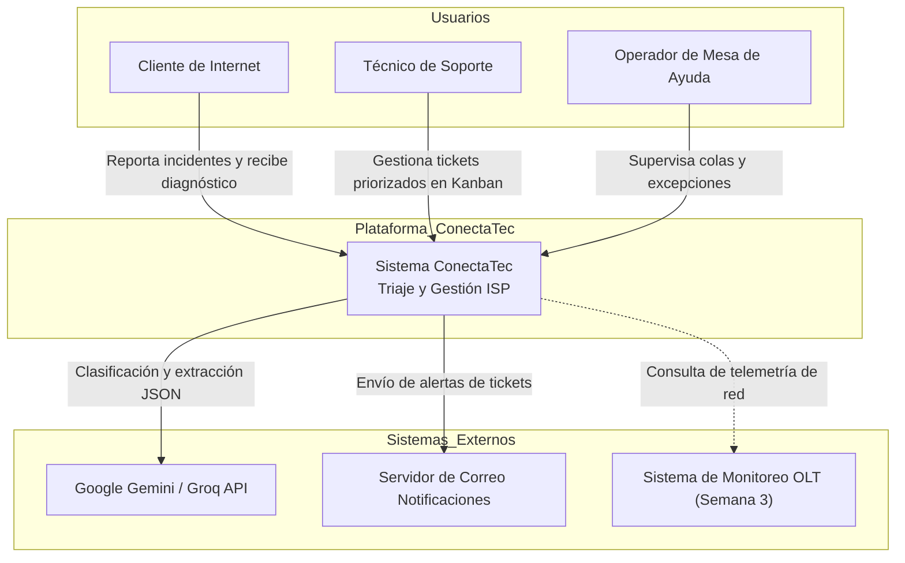
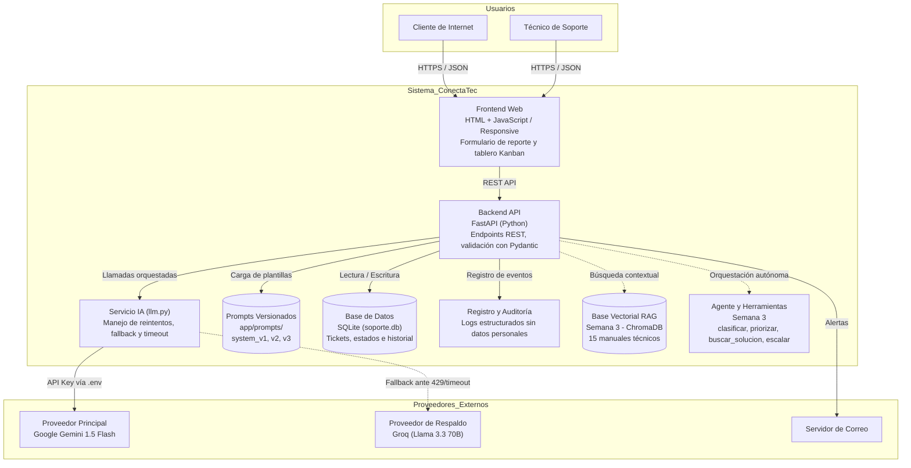
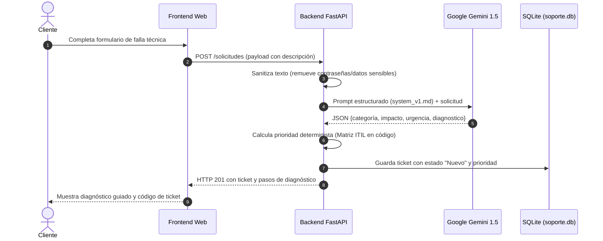

## 1. Contexto general del sistema

## 2. Arquitectura interna de ConectaTec

## 3. Endpoints principales

| Método | Endpoint | Propósito | Formato Entrada / Salida |
|--------|----------|-----------|---------------------------|
| POST | `/chat` | **Conversacional Interactivo (Streaming):** Diálogo técnico continuo token a token con asistencia en vivo. | **In:** `SolicitudChatIn` (Pydantic, `extra="forbid"`) **Out:** `StreamingResponse` (`text/plain; charset=utf-8` o SSE) |
| POST | `/clasificar` | **Triaje e Inferencia Estructurada:** Extracción de categoría, impacto y urgencia con cálculo ITIL determinista. | **In:** `SolicitudTicketIn` (Pydantic, `extra="forbid"`) **Out:** `TicketOut` (JSON estricto Pydantic) |
| POST | `/analizar` | **Diagnóstico Técnico de Averías:** Análisis de causas probables, severidad y pasos correctivos. | **In:** `SolicitudAnalizarIn` (Pydantic, `extra="forbid"`) **Out:** `ResultadoAnalizarOut` (JSON estricto Pydantic) |
| GET | `/v1/tickets` | Listado consolidado de tickets clasificados para el tablero técnico Kanban. | **In:** Query params opcionales **Out:** `ListaTicketsOut` (JSON) |
| PUT | `/v1/tickets/{codigo}/estado` | Actualiza el estado operativo de un ticket (`nuevo`, `en_atencion`, `resuelto`, `escalado_cuadrilla`). | **In:** `ActualizarEstadoIn` (JSON) **Out:** `TicketOut` (JSON) |
| GET | `/v1/salud` | Chequeo de salud del servicio backend, arquitectura y conectividad de modelos. | **In:** Ninguno **Out:** `{"status": "ok", "servicio": "conectatec-api"}` |

## 4. Secuencia de atención de una solicitud

## 5. Estrategia de tolerancia a fallos y manejo de errores del proveedor

El cliente encapsulado `ClienteLLM` implementa un perímetro determinista de resiliencia ante contingencias de los proveedores externos de IA:

1. **Error HTTP 429 (Cuota / Límite de Tasa) con Espera Exponencial:**
   - Si la API del proveedor responde con código `429 Too Many Requests` o `ResourceExhausted`, el cliente no falla de inmediato.
   - Aplica un ciclo de hasta **3 reintentos automáticos** gobernados por la fórmula de retroceso exponencial (*Exponential Backoff*):
     $$\text{Espera} = \text{base} \times 2^{\text{intento}} \quad (\text{con } \text{base} = 0.5\text{s})$$
   - Intervalos de espera sucesivos: 0.5s, 1.0s, 2.0s. Si la cuota continúa agotada tras agotar los reintentos, se levanta `ErrorCuotaExcedidaLLM` y se conmuta de inmediato al proveedor secundario.

2. **Control de Tiempo Agotado (Timeout):**
   - Cada llamada HTTP a los SDKs de LLM está limitada por un umbral estricto (`timeout = 12.0s`).
   - Si la conexión se estanca o el proveedor no responde en el tiempo fijado, se interceptan excepciones de tipo `httpx.TimeoutException` y `socket.timeout`, levantando `ErrorTiempoAgotadoLLM` para conmutar sin congelar el hilo de ejecución ni bloquear el backend.

3. **Detección y Contención de Respuesta Vacía:**
   - Si el proveedor devuelve un payload JSON sin candidatos (`candidates: []`), opciones vacías (`choices: []`), texto en blanco (`""`) o contenido suprimido por filtros de moderación (*Safety Blocks*), el sistema lo intercepta con `ErrorRespuestaVaciaLLM`.
   - Se evita que un `None` o cadena vacía rompa la validación estricta de esquemas Pydantic V2, activando el siguiente proveedor en la cadena de contingencia.

4. **Cadena de Conmutación Transparente y Auditoría:**
   - **Orden de Cascada:** $\text{Google Gemini 1.5 Flash} \longrightarrow \text{Groq Cloud Llama 3.3 70B} \longrightarrow \text{Motor Local Heurístico Offline}$.
   - **Trazabilidad:** Cada conmutación registra el motivo exacto en `metadatos_ia.conmutado = True` y `metadatos_ia.motivo_conmutacion`, informando al operador en la API y en el frontend.

## 6. Encapsulamiento del Cliente LLM (`app/services/llm.py`)

### Principio Rector
> ***«El cliente del modelo está encapsulado: cambiar de proveedor no toca los endpoints.»***

1. **Aislamiento de la Capa de Inferencia (Patrón Gateway / Strategy):**
   * Toda la comunicación con SDKs externos de inteligencia artificial (Google Gemini API, Groq Cloud, modelos locales) se encuentra confinada exclusivamente en la clase `ClienteLLM` dentro de `app/services/llm.py`.
   * Los enrutadores de FastAPI (`app/routers/principal.py` y `app/routers/tickets.py`) interactúan con la interfaz unificada del cliente: `cliente_llm.clasificar()`, `cliente_llm.chat_stream()` y `cliente_llm.analizar()`.

2. **Conmutación sin Modificar Endpoints:**
   * **Por Variable de Entorno:** Configurando `PROVEEDOR_LLM_ACTIVO=groq` o `PROVEEDOR_LLM_ACTIVO=gemini` en `.env`.
   * **En Tiempo de Ejecución:** Mediante `cliente_llm.cambiar_proveedor("groq")`.
   * **Invarianza de Contratos:** Los endpoints continúan recibiendo y emitiendo los mismos esquemas estrictos Pydantic V2 (`SolicitudTicketIn`, `TicketOut`, `SolicitudChatIn`, `ResultadoAnalizarOut`). Ninguna línea de los controladores HTTP necesita modificarse al cambiar de proveedor de LLM.

