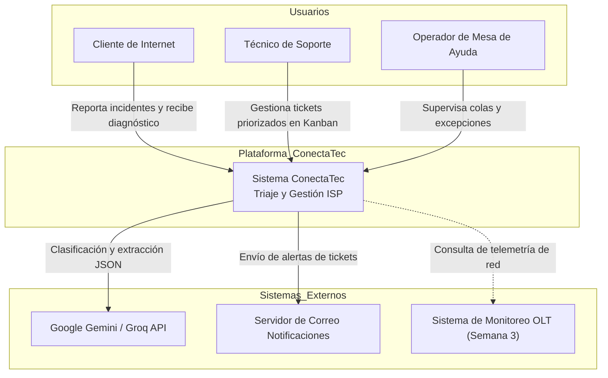
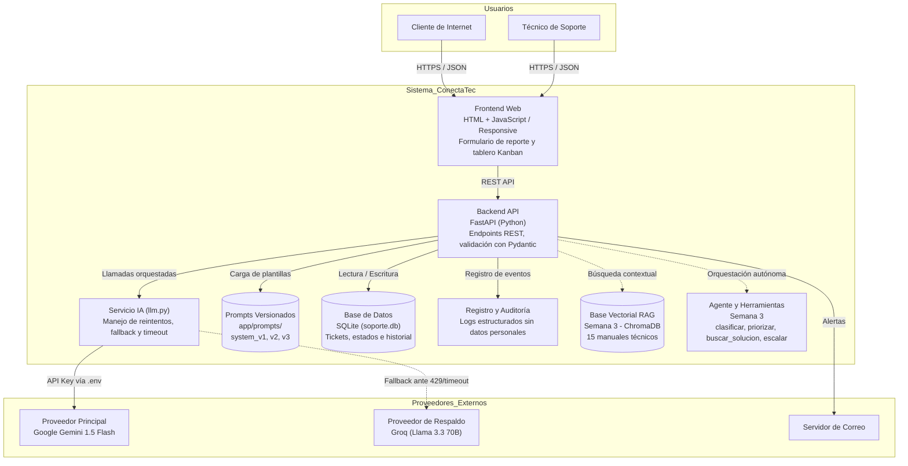
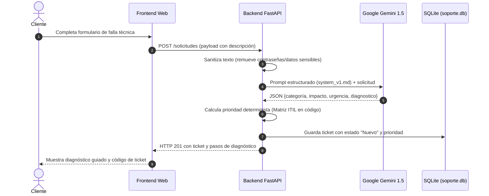

## 1. Contexto general del sistema

## 2. Arquitectura interna de ConectaTec

## 3. Endpoints principales

| Método | Endpoint | Propósito | Formato Entrada / Salida |
|--------|----------|-----------|---------------------------|
| POST | `/chat` | **Conversacional Interactivo (Streaming):** Diálogo técnico continuo token a token con asistencia en vivo. | **In:** `SolicitudChatIn` (Pydantic, `extra="forbid"`) **Out:** `StreamingResponse` (`text/plain; charset=utf-8` o SSE) |
| POST | `/clasificar` | **Triaje e Inferencia Estructurada:** Extracción de categoría, impacto y urgencia con cálculo ITIL determinista. | **In:** `SolicitudTicketIn` (Pydantic, `extra="forbid"`) **Out:** `TicketOut` (JSON estricto Pydantic) |
| POST | `/analizar` | **Diagnóstico Técnico de Averías:** Análisis de causas probables, severidad y pasos correctivos. | **In:** `SolicitudAnalizarIn` (Pydantic, `extra="forbid"`) **Out:** `ResultadoAnalizarOut` (JSON estricto Pydantic) |
| GET | `/v1/tickets` | Listado consolidado de tickets clasificados para el tablero técnico Kanban. | **In:** Query params opcionales **Out:** `ListaTicketsOut` (JSON) |
| PUT | `/v1/tickets/{codigo}/estado` | Actualiza el estado operativo de un ticket (`nuevo`, `en_atencion`, `resuelto`, `escalado_cuadrilla`). | **In:** `ActualizarEstadoIn` (JSON) **Out:** `TicketOut` (JSON) |
| GET | `/v1/salud` | Chequeo de salud del servicio backend, arquitectura y conectividad de modelos. | **In:** Ninguno **Out:** `{"status": "ok", "servicio": "conectatec-api"}` |

## 4. Secuencia de atención de una solicitud

## 5. Estrategia de tolerancia a fallos

**Llamada principal:** Toda solicitud de inferencia se dirige inicialmente a Google Gemini 1.5 Flash con un tiempo límite (`timeout`) de 3 segundos.

**Reintentos:** Se aplica reintento con retroceso exponencial (*exponential backoff*) ante errores transitorios de red.

**Conmutación por falla (Fallback):** Si la API responde con límite de tasa (HTTP 429) o falla de servicio (HTTP 5xx), el cliente conmuta de inmediato a Groq con el modelo `llama-3.3-70b-versatile`.

**Degradación elegante:** Si ambos proveedores fallan, el ticket se registra automáticamente en estado `Nuevo` con prioridad por defecto `Media` para revisión manual, garantizando que el usuario nunca pierda su reporte.
