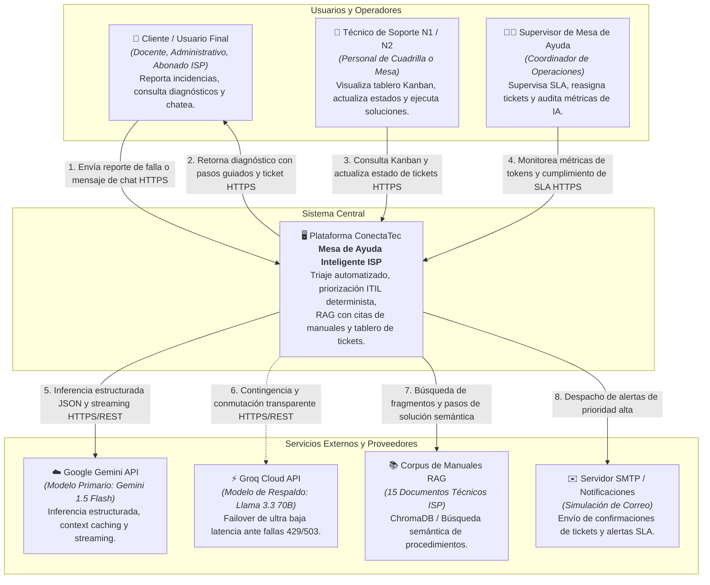
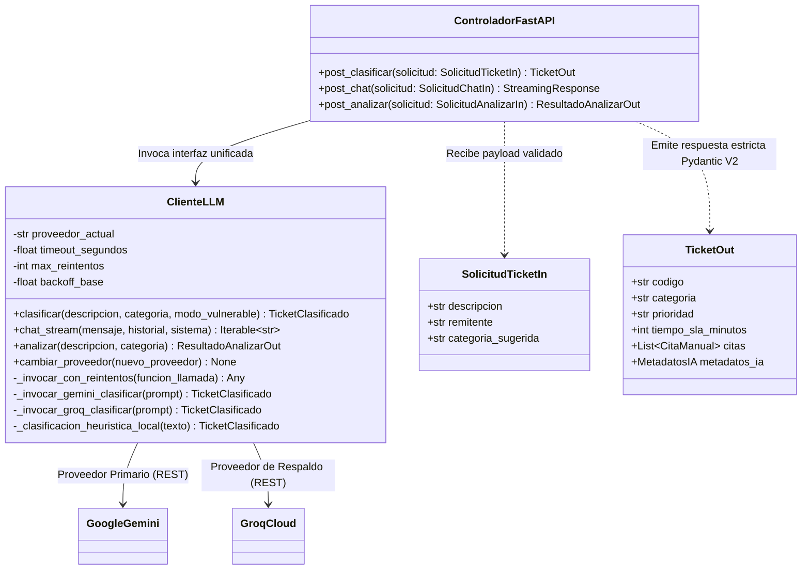
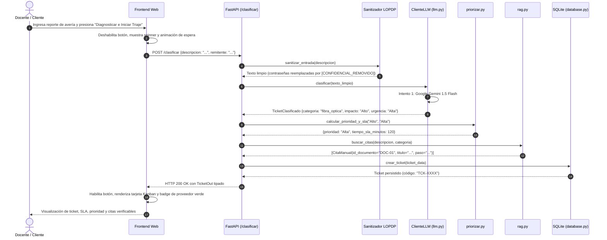
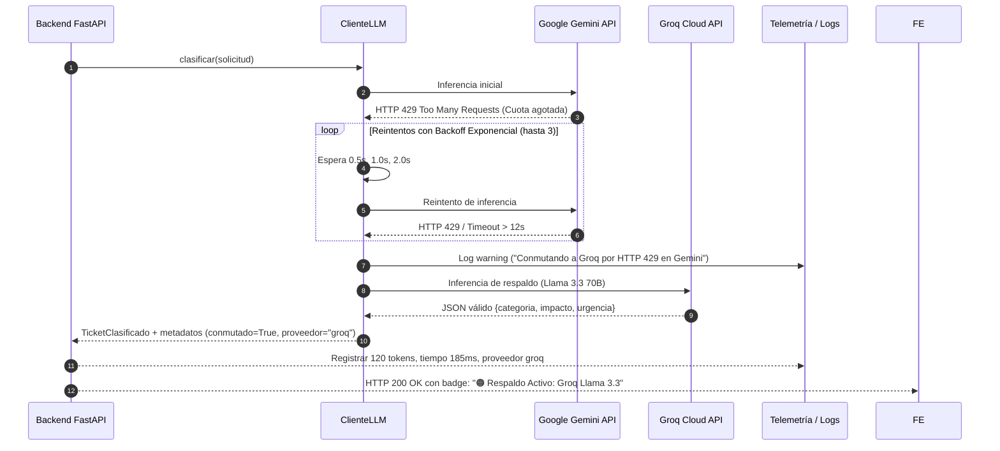

# Arquitectura de Software ConectaTec (Modelo C4)
**Proyecto:** ConectaTec — Mesa de Ayuda Inteligente para Proveedores de Servicios de Internet (ISP)  
**Seminario de Titulación:** Ingeniería de Software con IA Generativa — UNIANDES (2026)  
**Integrantes:** Christian Morales, Luis Fernando Ribera, Amalia Geoconda Iguasnia  
**Docente Evaluador:** Heyler Fabio Guaza  
**Versión:** 2.0 (Revisión Final Actualizada)

---

## 1. Nivel 1: Diagrama de Contexto del Sistema (System Context)

El diagrama de contexto ilustra la posición de **ConectaTec** en su ecosistema operativo, delimitando a los usuarios que interactúan con la plataforma y los sistemas externos con los que se integra.



---

## 2. Nivel 2: Diagrama de Contenedores (Containers)

El diagrama de contenedores describe la arquitectura física y lógica de alto nivel: la aplicación web monorepo desacoplada en Frontend Web, API Backend, Bases de Datos y Almacén de Telemetría.

```mermaid
flowchart TD
    subgraph Cliente_Navegador["Navegador Web del Cliente / Operador"]
        SPA["🌐 Frontend Web (SPA)<br/><b>HTML5 + CSS3 Nativo + JavaScript Vanilla</b><br/>Formulario reactivo, botón deshabilitado con spinner,<br/>tablero Kanban interactivo, consola de chat streaming y badge de telemetría."]
    end

    subgraph Servidor_Aplicacion["Perímetro de Aplicación (Host Local / VPS)"]
        API["⚙️ Backend API REST<br/><b>FastAPI (Python 3.10+) + Uvicorn + AnyIO</b><br/>Endpoints asíncronos y síncronos en threadpool,<br/>validación estricta Pydantic V2, rate limiting Token Bucket,<br/>control de errores RFC 9457 y filtro LOPDP."]

        LLM_GW["🛡️ Gateway de Inferencia LLM<br/><b>app/services/llm.py (ClienteLLM)</b><br/>Patrón Gateway/Strategy, manejo de errores 429 con backoff exponencial,<br/>timeout de 12s, mitigación de respuestas vacías y registro de tokens."]

        ITIL_CORE["📐 Motor Determinista ITIL<br/><b>app/tools/priorizar.py</b><br/>Cálculo matemático de prioridad (Alta/Media/Baja) y tiempos SLA<br/>leyendo <code>config/matriz_prioridad.json</code>."]

        RAG_SRV["🔍 Servicio RAG de Búsqueda<br/><b>app/services/rag.py</b><br/>Recuperación de fragmentos técnicos verificables<br/>con citas exactas (DOC-01 a DOC-15)."]

        SQLITE[("💾 Base de Datos Relacional<br/><b>SQLite (data/conectatec.db)</b><br/>Persistencia parametrizada de tickets, estados,<br/>marcas de tiempo y citas asociadas.")]

        TELEMETRIA[("📊 Almacén de Observabilidad<br/><b>Memoria / logs de auditoría</b><br/>Telemetría de tokens consumidos (in/out/total)<br/>y latencia de respuesta por solicitud.")]
    end

    subgraph Nube_IA["Proveedores Externos de IA"]
        GEMINI_EXT["☁️ Google Gemini 1.5 Flash"]
        GROQ_EXT["⚡ Groq Cloud Llama 3.3 70B"]
    end

    SPA -->|JSON REST / SSE Streaming| API
    API -->|Sanitiza y orquesta| LLM_GW
    API -->|Calcula prioridad sin LLM| ITIL_CORE
    API -->|Consulta manuales aplicables| RAG_SRV
    API -->|Consultas parametrizadas SQL (?) | SQLITE
    API -->|Registra métricas por solicitud| TELEMETRIA

    LLM_GW -->|HTTPS REST con API Key (.env)| GEMINI_EXT
    LLM_GW -.->|Failover automático ante 429/503/Timeout| GROQ_EXT
```

---

## 3. Nivel 3: Diagrama de Componentes del Backend (Components)

Detalle de los módulos internos del backend FastAPI (`app/`), mostrando el flujo de datos entre enrutadores, esquemas, servicios de inteligencia artificial y almacenamiento.

```mermaid
flowchart TD
    subgraph Routers["Controladores REST (app/routers/)"]
        R_PRINC["principal.py<br/>POST /clasificar<br/>POST /chat<br/>POST /analizar"]
        R_TICKETS["tickets.py<br/>GET /v1/tickets<br/>PUT /v1/tickets/{c}/estado"]
        R_METRICAS["metricas.py<br/>GET /v1/metricas/solicitudes"]
        R_SALUD["salud.py<br/>GET /v1/salud"]
    end

    subgraph Capa_Validacion["Validación de Contratos (app/schemas.py)"]
        SCH_IN["SolicitudTicketIn / SolicitudChatIn<br/><i>Pydantic V2 (extra='forbid')</i>"]
        SCH_OUT["TicketOut / ResultadoAnalizarOut<br/><i>Contratos tipados y blindados</i>"]
    end

    subgraph Capa_Seguridad["Seguridad y Privacidad (app/tools/)"]
        RATE_LIM["Token Bucket Limiter<br/><i>10 tokens, 1 cada 6s (RFC 6585)</i>"]
        LOPDP["Sanitizador LOPDP<br/><i>Anonimización de contraseñas y PII</i>"]
        ERR_HANDLER["RFC 9457 Problem Details<br/><i>application/problem+json</i>"]
    end

    subgraph Capa_Servicios["Lógica de Negocio y Servicios (app/services/)"]
        GATEWAY["ClienteLLM (llm.py)<br/>• clasificar()<br/>• chat_stream()<br/>• analizar()"]
        BACKOFF["Gestor de Reintentos<br/><i>Backoff Exponencial 0.5s × 2^i</i>"]
        OBSERV["Módulo de Telemetría<br/><i>Conteo de tokens y latencias</i>"]
        RAG_CORE["rag.py<br/><i>Matcheo semántico y citas DOC-XX</i>"]
    end

    subgraph Capa_Herramientas["Herramientas Deterministas"]
        PRIORIZAR["priorizar.py<br/><i>Matriz Impacto × Urgencia</i>"]
        MATRIZ_CFG[("matriz_prioridad.json")]
    end

    subgraph Capa_Datos["Persistencia (app/database.py)"]
        DB_REPO["Funciones de Acceso a Datos<br/><i>crear_ticket, listar_tickets, actualizar</i>"]
        DB_FILE[("SQLite soporte.db")]
    end

    %% Relaciones
    R_PRINC --> SCH_IN
    R_PRINC --> RATE_LIM
    R_PRINC --> LOPDP
    R_PRINC --> GATEWAY
    R_PRINC --> PRIORIZAR
    R_PRINC --> RAG_CORE
    R_PRINC --> DB_REPO
    R_PRINC --> OBSERV
    R_PRINC --> SCH_OUT

    GATEWAY --> BACKOFF
    GATEWAY --> OBSERV
    PRIORIZAR --> MATRIZ_CFG
    DB_REPO --> DB_FILE

    R_TICKETS --> DB_REPO
    R_METRICAS --> OBSERV
```



---

## 4. Nivel 4: Diagrama de Código y Patrones de Ejecución (Code & Patterns)

### 4.1. Patrón Gateway / Strategy para Encapsulamiento del LLM

El cliente `ClienteLLM` desacopla completamente los controladores HTTP de los proveedores externos de IA. Cambiar de proveedor en tiempo de ejecución o por configuración de entorno **no altera los endpoints ni sus firmas**.



---

## 5. Dinámica de Secuencia: Triaje Inteligente y Manejo de Errores

### 5.1. Secuencia de Atención Exitosa con Validación ITIL Determinista



### 5.2. Secuencia de Conmutación Transparente ante Falla de Proveedor (HTTP 429 / Timeout)



---

## 6. Endpoints Principales y Contratos de la API

| Método | Endpoint | Propósito Arquitectónico | Contrato Entrada | Contrato Salida |
|---|---|---|---|---|
| `POST` | `/clasificar` | Triaje estructurado con inferencia LLM, cálculo ITIL determinista y RAG. | `SolicitudTicketIn` (`extra="forbid"`) | `TicketOut` (Pydantic V2) |
| `POST` | `/chat` | Conversación interactiva token a token con streaming. | `SolicitudChatIn` (`extra="forbid"`) | `StreamingResponse` (`text/plain`) |
| `POST` | `/analizar` | Diagnóstico de averías, severidad técnica y pasos de resolución. | `SolicitudAnalizarIn` (`extra="forbid"`) | `ResultadoAnalizarOut` (Pydantic V2) |
| `GET` | `/v1/tickets` | Consulta consolidada de incidencias para el tablero Kanban. | Parámetros de consulta opcionales | `ListaTicketsOut` (JSON) |
| `PUT` | `/v1/tickets/{codigo}/estado` | Transición de estado en el ciclo de vida del ticket. | `ActualizarEstadoIn` | `TicketOut` (JSON) |
| `GET` | `/v1/metricas/solicitudes` | Auditoría de tokens, tiempos de respuesta y conmutaciones. | Ninguno | `ResumenMetricasOut` (JSON) |
| `GET` | `/v1/salud` | Liveness/Readiness probe para balanceadores y monitoreo. | Ninguno | `{"status": "ok"}` |

---

## 7. Estrategia de Pruebas Unitarias con Mocks y Cero Consumo de API

Para asegurar la verificabilidad del sistema en cualquier entorno de evaluación y garantizar **cero consumo de saldo o tokens de API**, la arquitectura incorpora un arnés de pruebas desacoplado:

1. **Aislamiento Total mediante `monkeypatch`:**
   - La suite de pruebas en `tests/test_endpoints.py` mockea las llamadas a `cliente_llm.clasificar()`, `cliente_llm.chat_stream()` y `cliente_llm.analizar()`.
   - Se validan de punta a punta las capas de validación Pydantic V2, cálculo ITIL, persistencia SQLite y formato de salida sin emitir ninguna petición HTTP hacia los servidores de Google o Groq.
2. **Garantía Offline (Sin Conexión a Internet):**
   - Una prueba específica (`test_mock_garantia_cero_consumo_api_y_cero_red`) elimina las variables `GEMINI_API_KEY` y `GROQ_API_KEY` en tiempo de ejecución, demostrando que la suite completa (28 pruebas) ejecuta y aprueba al 100% en tan solo **3.4 segundos**.
3. **Determinismo y Resiliencia:**
   - Se eliminan las pruebas intermitentes (*flaky tests*) causadas por fluctuaciones en las APIs de proveedores externos o restricciones de cuota compartida.
