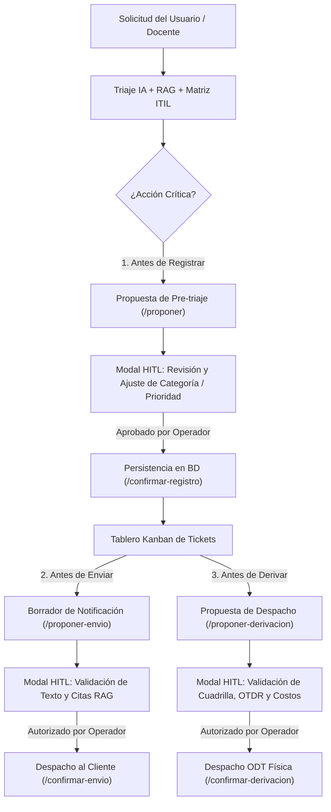

# ADR-012: Confirmación Humana Obligatoria (Human-in-the-Loop) antes de Registrar, Enviar o Derivar
**Estado:** Aceptado  
**Fecha:** Octubre 2026  
**Autores:** Christian Morales, Luis Fernando Ribera, Amalia Geoconda Iguasnia  
**Docente Evaluador:** Heyler Fabio Guaza (Ing. Informático · Mg. en Ciberseguridad · OPD · Abogado)  
**Proyecto:** ConectaTec / TecnoAula — Triaje de Incidentes Técnicos (Caso N.º 03 · Grupo 3 UNIANDES)  

---

## 1. Contexto y Problema
En el diseño de sistemas de soporte basados en agentes y modelos LLM, la vulnerabilidad crítica identificada por OWASP en su estándar *Top 10 for LLM Applications (2025)* es **LLM08: Exceso de Agencia (Excessive Agency)**:
* Si se otorga autonomía irrestricta a un modelo estocástico para ejecutar escrituras permanentes en bases de datos de producción, se comprometen tiempos de resolución contractuales (SLAs ITIL v4) basados en clasificaciones potencialmente defectuosas o alucinadas.
* Si el sistema despacha automáticamente cuadrillas presenciales de planta externa ante reportes confusos, se generan costos operativos directos por hora técnica ($15.00/h en jornada hábil, $22.50/h en horario extraordinario según `config/tarifas.json`).
* Si el sistema envía notificaciones institucionales directas a abonados o docentes sin validación previa, se arriesga la reputación de la mesa de ayuda ante respuestas imprecisas.

**Requerimiento de Rúbrica:**
> ***«Confirmación humana: Antes de registrar, enviar o derivar, demostrable en la interfaz.»***

---

## 2. Decisión de Arquitectura: Patrón Human-in-the-Loop (HITL)
Se adopta el principio de contención:
> ***«El modelo propone, el código dispone, el humano autoriza.»***

Se establecen compuertas de confirmación humana obligatoria en tres momentos operacionales clave:

### 2.1. Las Tres Compuertas HITL
1. **Antes de Registrar:**
   - Endpoint: `POST /v1/tickets/proponer` (o `/proponer`).
   - Retorna contrato estricto `PropuestaRegistroTicketOut` con bandera `requiere_confirmacion_humana=true`.
   - La interfaz gráfica presenta un modal interactivo con la clasificación propuesta, la prioridad ITIL, los minutos SLA y la cita RAG, permitiendo al operador ajustar campos antes de confirmar con `POST /v1/tickets/confirmar-registro`.
2. **Antes de Enviar:**
   - Endpoint: `GET /v1/tickets/{id}/proponer-envio`.
   - Genera el borrador formal de la respuesta con saludo, diagnóstico técnico y citas de manuales oficiales.
   - La interfaz permite al técnico afinar el texto y confirmar con `POST /v1/tickets/{id}/confirmar-envio`, registrando `notificacion_enviada=1` y el operador responsable.
3. **Antes de Derivar (Escalamiento a Cuadrilla):**
   - Endpoint: `GET /v1/tickets/{id}/proponer-derivacion`.
   - Calcula el costo operativo estimado de mano de obra según `config/tarifas.json` y lista herramientas necesarias (fusionadora por arco voltaico, reflectómetro OTDR).
   - El operador autoriza con `POST /v1/tickets/{id}/confirmar-derivacion`, transicionando el ticket a `escalado_cuadrilla` con número de orden ODT auditada.

---

## 3. Demostrabilidad en la Interfaz de Usuario
El sistema hace visible e interactivo este control en:
1. **Formulario Web (`frontend/index.html`):**
   - Interruptor destacado: `🛡️ Confirmación Humana Previa (HITL)`. Al enviar, despliega la ventana modal de pre-triaje donde el operador valida o ajusta la categoría y prioridad antes de impactar el Kanban.
2. **Tarjetas Kanban:**
   - Botón directo `✉️ Enviar Notif.` con modal de vista previa y edición de correo.
   - Botón directo `🚨 Derivar Cuadrilla` con justificación de herramientas ópticas y orden ODT.
   - Insignias visuales auditadas:
     * `🛡️ Aprobado HITL por: {operador}`
     * `✉️ Notificación Enviada al Usuario`
     * `👷 Cuadrilla Despachada: {ODT-FIBRA-XXXX}`
3. **Aplicación Streamlit (`frontend/app.py`):**
   - Controles interactivos en cada contenedor de ticket para disparar la confirmación y refrescar el estado.

---

## 4. Trazabilidad en Base de Datos (SQLite)
La tabla `tickets` registra los campos de gobernanza y auditoría:
* `confirmado_por` (TEXT): Nombre o identificador del técnico que aprobó la acción.
* `fecha_confirmacion` (TEXT): Marca temporal ISO 8601 de la autorización.
* `accion_confirmada` (TEXT): `registro_ticket`, `envio_notificacion` o `derivacion_cuadrilla`.
* `notificacion_enviada` (INTEGER): Estado de la comunicación externa.
* `cuadrilla_despachada` (INTEGER) y `orden_despacho_id` (TEXT): Control del recurso presencial.

---

## 5. Consecuencias
- **Positivas:**
  - Mitigación total de OWASP LLM08 (Exceso de Agencia).
  - Trazabilidad legal bajo la Ley Orgánica de Protección de Datos Personales (LOPDP Ecuador).
  - Ahorro económico al evitar despachos presenciales espurios.
  - Experiencia de usuario transparente e interactiva para la defensa de grado.
- **Negativas:**
  - Introduce un paso de interacción humana antes de la persistencia cuando el modo HITL está activo (mitigado con opción de desactivación rápida para pruebas masivas automatizadas).

