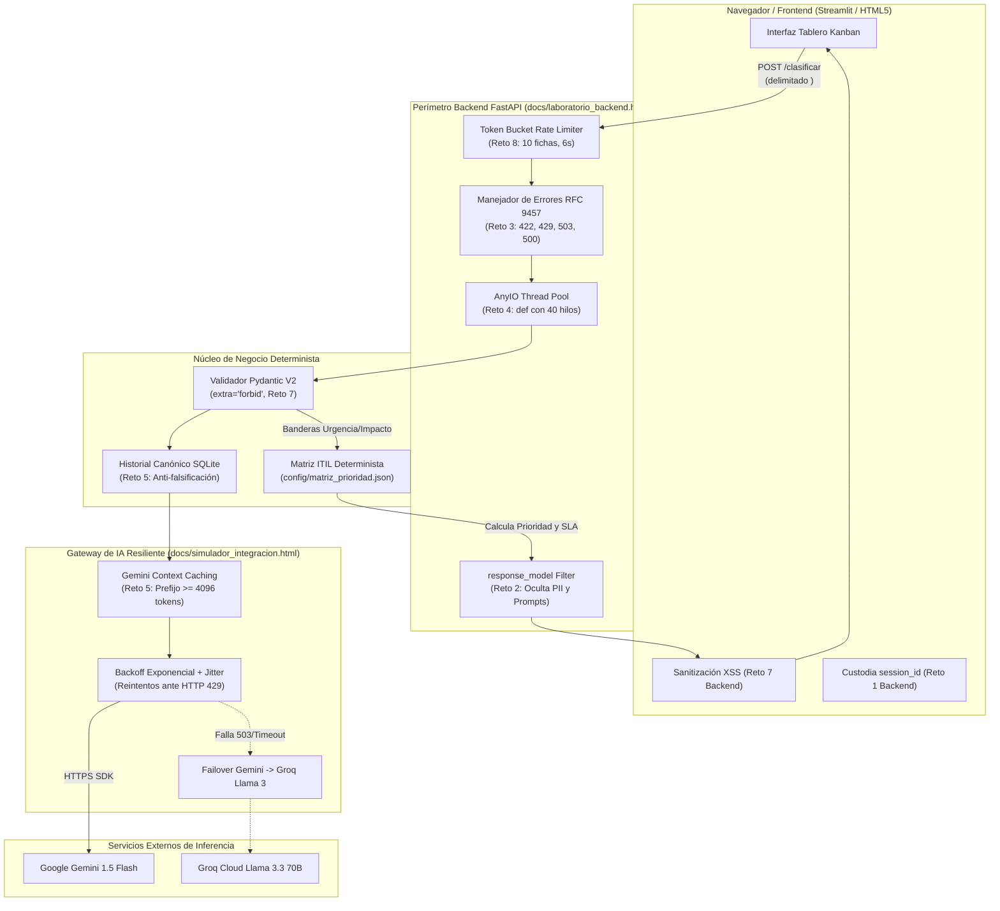

# Compendio de Laboratorios y Ejercicios Prácticos · Semanas 1 y 2
**Seminario de Titulación: Ingeniería de Software con IA Generativa — Desarrollo de Aplicaciones Inteligentes**  
**Carrera de Software · Universidad Regional Autónoma de los Andes (UNIANDES)**  
**Docente:** Heyler Fabio Guaza (Ing. Informático · Mg. en Ciberseguridad · OPD · Abogado)  
**Grupo de Desarrollo N.º 03:**  
- Ribera Alajo Luis Fernando  
- Morales Gonzalez Christian Guillermo  
- Iguasnia Escobar Amalia Geoconda  
**Proyecto Asignado:** **TecnoAula — Mesa de Ayuda Inteligente para Instituciones Educativas** (Caso N.º 03)  

---

## 1. Visión General de los Entornos Prácticos Interactivos

Durante las primeras dos semanas del seminario, el aprendizaje teórico se complementó de manera continua con **laboratorios interactivos de ejecución local en el navegador**, diseñados para experimentar en tiempo real con infraestructura física, ingeniería de prompts, seguridad, arquitectura de software y desarrollo de backend seguro sin incurrir en consumo de créditos de API externos.

La siguiente matriz consolida los entornos de laboratorio provistos en clase, su archivo fuente en el repositorio, la competencia desarrollada y su aplicación directa en el proyecto **TecnoAula**:

| Semana / Clase | Entorno / Herramienta | Archivo en Repositorio | Núcleo Técnico y Competencia Evaluada | Aplicación en TecnoAula (Grupo 3) |
| :--- | :--- | :--- | :--- | :--- |
| **S1 · C1** | **Bajo el Capó de un LLM** | [`docs/bajo_el_capo_llm.html`](file:///c:/Users/Cris/Downloads/Programas%20APP/Seminario/APP%20IA/docs/bajo_el_capo_llm.html) | Arquitectura física (H100/B200), cálculo de FLOPs ($6 \times N \times D$), memoria KV-Cache, stack de 10 capas y traza de streaming. | Dimensión de infraestructura, estimación de latencia y costos en inferencia de tickets. |
| **S1 · C2** | **Manual y Portal R.E.C.E.T.A.** | [`docs/manual_laboratorio_receta.html`](file:///c:/Users/Cris/Downloads/Programas%20APP/Seminario/APP%20IA/docs/manual_laboratorio_receta.html) | Formulación algorítmica de prompts en 6 dimensiones, delimitación con XML, historias BDD Gherkin y calibración. | Prompt de clasificación multiclase (`<solicitud>`), extracción de entidades y criterios de aceptación. |
| **S1 · C3** | **Laboratorio E-P-C-C (Pyodide)** | [`docs/laboratorio_clase_3.html`](file:///c:/Users/Cris/Downloads/Programas%20APP/Seminario/APP%20IA/docs/laboratorio_clase_3.html) | Ciclo E-P-C-C, desarrollo guiado por pruebas (TDD), ejecución de `pytest` en WebAssembly y refactorización limpia. | Suite de pruebas unitarias (`tests/test_endpoints.py`) sin debilitar aserciones. |
| **S1 · C4** | **Laboratorio de Seguridad y LOPDP** | [`docs/laboratorio_clase_4.html`](file:///c:/Users/Cris/Downloads/Programas%20APP/Seminario/APP%20IA/docs/laboratorio_clase_4.html) | Mitigación de inyecciones SQL, detección y anonimización regex de contraseñas y verificación Crossref DOI. | Sanitización estricta de contraseñas en correos de usuarios y protección de base SQLite. |
| **S1 · C4** | **Matriz Radar V.E.R.I.F.I.C.A.** | [`docs/matriz_verifica.html`](file:///c:/Users/Cris/Downloads/Programas%20APP/Seminario/APP%20IA/docs/matriz_verifica.html) | Evaluación heurística de respuestas generadas (8 dimensiones radar) y cálculo de confiabilidad. | Auditoría de respuestas generadas antes de ser enviadas a técnicos de soporte. |
| **S2 · C1** | **Estudio Arquitectura MVP (C4)** | [`docs/estudio_arquitectura_mvp.html`](file:///c:/Users/Cris/Downloads/Programas%20APP/Seminario/APP%20IA/docs/estudio_arquitectura_mvp.html) | Modelado C4 en 4 niveles (Contexto, Contenedores, Componentes, Código) y generación de diagramas Mermaid + ADRs. | Arquitectura global de TecnoAula (FastAPI, Streamlit, ChromaDB, SQLite). |
| **S2 · C2** | **Simulador de Integración y 429** | [`docs/simulador_integracion.html`](file:///c:/Users/Cris/Downloads/Programas%20APP/Seminario/APP%20IA/docs/simulador_integracion.html) | Simulación de olas de concurrencia, backoff exponencial + jitter ante 429, validador Pydantic de 6 etapas y costeo. | Gateway de resiliencia (`app/services/llm.py`) con conmutación por error a Groq. |
| **S2 · C3** | **Laboratorio de Backend Seguro** | [`docs/laboratorio_backend.html`](file:///c:/Users/Cris/Downloads/Programas%20APP/Seminario/APP%20IA/docs/laboratorio_backend.html) | 8 retos de ingeniería: frontera de confianza, `response_model`, RFC 9457, AnyIO hilos, context caching, streaming, inyección y token bucket. | Endpoints robustos en `app/main.py`, defensa contra OWASP LLM01/02/05 y limitador de velocidad. |

---

## 2. Laboratorio 1: «Bajo el Capó de un LLM» (Semana 1 · Clase 1)

### 2.1. Objetivos del Entorno
Comprender la base material, económica y computacional sobre la cual operan los modelos de lenguaje, erradicando la noción del LLM como «caja negra mágica» y fundamentando las decisiones de diseño en principios de ingeniería física.

### 2.2. Componentes Clave Demostrados
1. **Infraestructura Física Escalar (del Chip al Centro de Datos):**
   - **Chip (GPU):** Unidad de cálculo matricial masivo. Análisis de la NVIDIA H100 SXM (80 GB de memoria HBM3 apilada sobre interposer CoWoS, 3.35 TB/s de ancho de banda de memoria, 989 TFLOPS en BF16 y consumo de 700 W).
   - **Servidor:** Chasis HGX H100 de 8 GPUs interconectadas por enlaces bidireccionales NVLink a 900 GB/s, 2 CPUs de control, discos NVMe y consumo nominal de 10.2 kW.
   - **Rack:** Armario computacional (ej. NVIDIA GB200 NVL72 con 72 GPUs Blackwell y 36 CPUs Grace, consumo de 120 kW con refrigeración líquida directa al silicio).
   - **Clúster y Red:** Interconexión de miles de nodos vía InfiniBand Quantum-2 a 400 Gb/s. Ejemplo real: Meta entrenó Llama 3 405B con 16.384 GPUs durante 54 días continuos, sufriendo 419 fallos imprevistos de hardware (1 interrupción cada 3 horas, mitigada por *checkpoints* periódicos).
   - **Red Eléctrica:** Consumo global de centros de datos estimado por la IEA en 415 TWh en 2024 (~1.5% de la electricidad mundial, proyectado a duplicarse a 945 TWh para 2030).

2. **Calculadoras Operativas en el Navegador:**
   - **Cómputo de Entrenamiento:** Basado en las leyes de escalado de Kaplan et al. (2020) y Hoffmann et al. (2022) (*Chinchilla*):  
     $$\text{FLOPs} \approx 6 \times N \times D$$  
     Donde $N$ es el número de parámetros del modelo y $D$ es la cantidad de tokens de entrenamiento.
   - **Memoria Requerida para Inferencia:**  
     $$\text{Memoria Total} = (\text{Parámetros} \times \text{Bytes de Precisión}) + \text{Memoria KV-Cache}$$  
     - FP16/BF16: 2 bytes por parámetro.
     - FP8/INT8: 1 byte por parámetro.
     - INT4: 0.5 bytes por parámetro (cuantización).
     - KV-Cache: Almacena las representaciones clave-valor de los tokens ya procesados para evitar recalcular la atención ($O(N^2)$).

3. **Pila de Software de 10 Capas (Software Stack):**
   - `Capa 10: Aplicación` (FastAPI, Streamlit, React).
   - `Capa 09: API Gateway` (Autenticación HTTPS, gestión de cuotas, límites 429).
   - `Capa 08: Motor de Inferencia` (vLLM, TensorRT-LLM, PagedAttention).
   - `Capa 07: Evaluación y Post-Entrenamiento` (TRL, SFTTrainer, DPO, RLHF).
   - `Capa 06: Entrenamiento Distribuido` (Megatron-LM, DeepSpeed ZeRO-1/2/3).
   - `Capa 05: Framework de Aprendizaje` (PyTorch, JAX).
   - `Capa 04: Núcleos Optimizados` (FlashAttention-2, Triton, CUTLASS).
   - `Capa 03: Bibliotecas de Comunicación y Cómputo` (cuBLAS, cuDNN, NCCL `all-reduce`).
   - `Capa 02: Controlador y Plataforma de Hardware` (NVIDIA Driver, CUDA Toolkit, ROCm).
   - `Capa 01: Sistema Operativo y Orquestación` (Linux Kernel, Docker, Kubernetes, Slurm).

4. **Viaje de una Petición (Request Trace):**
   - Desglose cronológico entre fase de *prefill* (procesamiento paralelo del prompt completo) y fase de *decoding* (generación autorregresiva token a token enviada por streaming al cliente vía Server-Sent Events).

---

## 3. Laboratorio 2: «Manual del Laboratorio R.E.C.E.T.A.» (Semana 1 · Clase 2)

### 3.1. Objetivos del Entorno
Estandarizar la ingeniería de prompts para tareas de desarrollo de software bajo el método estructurado **R.E.C.E.T.A.**, garantizando salidas predecibles, delimitadas y verificables para la generación de especificaciones de usuario (Historias de Usuario ágiles con BDD Gherkin).

### 3.2. Estructura del Proceso en 6 Pasos
```
┌─────────────────┐     ┌──────────────────────┐     ┌────────────────────────┐
│  Paso 1: Datos  │ ──> │  Paso 2: Necesidad   │ ──> │  Paso 3: Prompt        │
│ (Grupo y Caso)  │     │  (Problema del Caso) │     │  R.E.C.E.T.A.          │
└─────────────────┘     └──────────────────────┘     └───────────┬────────────┘
                                                                 │
                                                                 ▼
┌─────────────────┐     ┌──────────────────────┐     ┌────────────────────────┐
│  Paso 6: Enviar │ <── │ Paso 5: Autoevaluación│ <── │ Paso 4: Historia       │
│ y Analizar      │     │ (10 Criterios)       │     │ de Usuario + Gherkin   │
└─────────────────┘     └──────────────────────┘     └────────────────────────┘
```

1. **Paso 1 · Datos del Estudiante:** Registro riguroso de nombres completos, grupo asignado (Grupo 3) y clave de clase.
2. **Paso 2 · Necesidad del Usuario:** Expresión concisa del dolor operativo del usuario final (ej. *"Docentes que no pueden proyectar clase y pierden 20 minutos esperando a un técnico sin saber el estado de su reporte"*), diferenciando tajantemente la necesidad humana de la solución técnica.
3. **Paso 3 · Prompt R.E.C.E.T.A.:** Aplicación de los 6 ingredientes:
   - **R (Rol):** Identidad experta contextualizada (*"Actúas como analista de requerimientos de software para mesa de ayuda educativa..."*).
   - **E (Entorno/Audiencia):** Contexto operativo y destinatario (*"Para docentes de colegios fiscales que reportan averías..."*).
   - **C (Comando):** Verbo de acción inequívoco y criterio medible (*"Redacta exactamente 1 historia de usuario ágil..."*).
   - **E (Ejemplo):** Inclusión de una muestra del formato esperado para guiar el aprendizaje *one-shot*.
   - **T (Tono/Técnica/Formato):** Especificación del formato exacto de salida (Gherkin BDD: `Dado / Cuando / Entonces`).
   - **A (Acotaciones/Límites):** Reglas negativas y límites estrictos (*"Usa únicamente la información delimitada en `<necesidad>`. Si falta un dato esencial, escribe 'FALTA' y no inventes"*).
4. **Paso 4 · Mejor Historia de Usuario:** Redacción de la historia seleccionada siguiendo el patrón *«Como [rol], quiero [acción], para [beneficio]»*, complementada obligatoriamente por escenarios de aceptación en sintaxis Gherkin.
5. **Paso 5 · Autoevaluación:** Calificación individual honesta en 10 casillas para calibrar el juicio crítico frente al análisis del motor.
6. **Paso 6 · Envío y Bucle de Calibración:** Recepción del diagnóstico algorítmico (0 a 10 puntos), identificación de ingredientes débiles/ausentes e iteración inmediata hacia la versión 2.

### 3.3. Rúbrica de Evaluación Automática (10 Puntos)

| Dimensión Evaluada | Puntos | Criterio de Verificación del Algoritmo |
| :--- | :---: | :--- |
| **Ingredientes R.E.C.E.T.A.** | 6.0 | 1 punto por cada letra presente; 0.5 puntos si está débil; 0 si está ausente. |
| **Criterios de Aceptación Gherkin** | 1.5 | Presencia obligatoria de los conectores `Dado`, `Cuando` y `Entonces`. |
| **Estructura de la Historia** | 1.0 | Presencia del patrón estándar `Como... quiero... para...`. |
| **Inclusión de la Necesidad** | 1.0 | Inclusión de la necesidad real del caso dentro del cuerpo del prompt. |
| **Delimitadores de Datos** | 0.5 | Aislamiento formal del texto del usuario mediante etiquetas XML (`<necesidad>...</necesidad>`) o separadores claros (`"""`). |
| **Total Máximo** | **10.0** | Puntaje orientativo previo a la revisión monográfica del docente. |

---

## 4. Laboratorio 3: «Laboratorio de Backend» (Semana 2 · Clase 3)

### 4.1. Filosofía Arquitectónica del Backend
El laboratorio implementa de forma práctica la directriz fundamental de la Semana 2:  
> ***«El modelo propone, el código dispone.»***  
> El LLM es un componente externo, probabilístico, falible y costoso; el backend es el perímetro seguro que impone esquemas, límites de consumo, validación estricta y lógica de negocio determinista.

### 4.2. Síntesis Operativa de los 8 Retos del Laboratorio

```
┌─────────────────────────────────────────────────────────────────────────────┐
│                          FRONTERA DE CONFIANZA                              │
├─────────────────────┬───────────────────────────┬───────────────────────────┤
│ NAVEGADOR (Cliente) │    BACKEND (FastAPI)      │   PROVEEDOR (Gemini/Groq) │
│ - No confiable      │ - Perímetro confiable     │ - Servicio externo        │
│ - Guarda session_id │ - Custodia API Keys       │ - Genera completaciones   │
│ - Renderiza texto   │ - Aplica matriz ITIL      │ - Salida no confiable     │
│   escapado (XSS)    │ - Token Bucket / LOPDP    │ - Sujeto a cuotas y 429   │
└─────────────────────┴───────────────────────────┴───────────────────────────┘
```

#### Reto 1 · Frontera de Confianza (Trust Boundaries)
Clasificación de responsabilidades del sistema en tres zonas aisladas:
- **Navegador (No Confiable):** Almacena únicamente el identificador de sesión (`session_id`). Todo dato proveniente del cliente se considera hostil. El frontend nunca debe custodiar la clave API ni calcular reglas de negocio.
- **Backend (Confiable):** Custodia secreta de `GEMINI_API_KEY` (leída desde `.env`), aplicación de la matriz determinista ITIL (`config/matriz_prioridad.json`), persistencia de conversaciones canónicas en SQLite y validación de longitud/esquemas.
- **Proveedor de IA (Externo):** Ejecuta la inferencia; sus respuestas son entradas no confiables que deben ser parseadas por Pydantic antes de usarse.

#### Reto 2 · Contrato de API y `response_model`
- **Mitigación de Fugas (OWASP LLM02 y LLM07):** Uso de `response_model=RespuestaAnalisis` en FastAPI para filtrar campos internos. Nunca deben exponerse al cliente:
  - `texto_original` con datos personales (violación del art. 23 LOPDP).
  - `system_prompt` (previene robo de propiedad intelectual y ataques de extracción).
  - `base_url_proveedor` o identificadores internos de infraestructura.
  - `costo_usd` o métricas de consumo de tokens.
- **Código de Estado HTTP:** Las operaciones de creación persistente (ej. guardar un ticket analizado) deben retornar **`201 Created`**, no un genérico `200 OK`.

#### Reto 3 · Errores Estructurados según RFC 9457
Implementación de respuestas con encabezado `Content-Type: application/problem+json` que contienen campos estándar (`type`, `title`, `status`, `detail`, `instance`).
- **422 Unprocessable Entity:** Entrada inválida (longitud menor a 10 caracteres).
- **429 Too Many Requests:** Cuota de sesión excedida; incluye encabezado `Retry-After: 6`.
- **503 Service Unavailable:** Caída de proveedores externos; incluye `Retry-After: 30`.
- **500 Internal Server Error:** Falla inesperada en Python; devuelve un identificador de rastreo (`instance: "/v1/tickets#req-7f3a"`), guardando el *stack trace* en logs internos y jamás exponiéndolo al usuario.
- **El caso del 200 OK en SalidaInvalida:** Si tras un reintento de corrección el LLM sigue generando un JSON roto, el sistema **no lanza un error HTTP 500**, sino que retorna **`200 OK`** con el indicador `requiere_revision_humana: true`. Esto constituye una decisión de negocio exitosa del flujo y no una caída del servidor.

#### Reto 4 · Concurrencia y Bloqueo en FastAPI
Demostración visual con 30 usuarios concurrentes y latencia de 4 segundos por llamada:
- **`async def` + cliente síncrono (Antipatrón Crítico):** Bloquea el bucle de eventos principal. El usuario 30 espera 120 segundos ($30 \times 4\text{ s}$).
- **`def` + cliente síncrono (Patrón del Kit Actual):** FastAPI delega automáticamente la ejecución al pool de 40 hilos de trabajo de AnyIO. Los 30 usuarios se procesan en paralelo y terminan en 4 segundos.
- **`async def` + cliente asíncrono (`AsyncOpenAI`):** Escala a miles de solicitudes en un solo hilo, pero requiere obligatoriamente un semáforo (`asyncio.Semaphore(10)`) para no agotar la tasa permitida del proveedor (ej. 30 RPM en Groq).

#### Reto 5 · Memoria de Conversación y Context Caching
- **Gemini Context Caching:** Se activa automáticamente en prefijos idénticos de $\ge 4.096$ tokens, reduciendo la latencia en un 50% y el costo de tokens de entrada en un 75%.
- **Orden Canónico del Prompt:**
  1. *Fijo:* System prompt con reglas, políticas y ejemplos (~4.600 tokens).
  2. *Semi-fijo:* Resumen condensado de turnos antiguos.
  3. *Dinámico:* Últimos $N$ turnos de conversación recuperados de SQLite.
  4. *Variable:* Pregunta actual del usuario.
- **Regla:** Nunca anteponer datos volátiles (como la fecha u hora actual con segundos) al inicio del prompt, ya que invalida el prefijo cacheado en cada llamada.
- **Seguridad en Memoria:** El frontend solo envía su `session_id`; el backend reconstruye la historia desde la base de datos para impedir que un usuario malicioso inyecte turnos falsos aprobando reembolsos o permisos administrativos.

#### Reto 6 · Streaming (SSE) vs. Salidas Estructuradas
- **Server-Sent Events (SSE):** Ideal para texto conversacional libre, logrando un tiempo hasta el primer token (TTFT) inferior a 0.5 segundos, frente a más de 5 segundos de espera con respuestas bloqueantes.
- **Prohibición de Streaming en JSON:** Los fragmentos parciales de JSON no se pueden parsear ni validar con Pydantic durante la transmisión. Toda salida estructurada debe generarse y validarse de forma completa antes de emitirse al consumidor.

#### Reto 7 · Defensa en Profundidad contra Inyección de Prompts
Implementación simultánea de 4 barreras defensivas:
1. **Delimitación Semántica:** Aislamiento de la entrada del usuario mediante etiquetas XML (`<solicitud>...</solicitud>`), neutralizando instrucciones hostiles como *"IGNORA TUS INSTRUCCIONES ANTERIORES"*.
2. **Esquema Pydantic Cerrado:** Declaración de `model_config = ConfigDict(extra="forbid")`, rechazando campos no autorizados inyectados en el prompt (ej. `"descuento": 100`).
3. **Decisiones Deterministas en Código:** Las acciones críticas (escalamiento a soporte físico, tiempos de SLA) se ejecutan mediante código Python evaluando banderas booleanas, sin depender de la prosa persuasiva del modelo.
4. **Sanitización en Frontend:** El cliente web renderiza texto escapado o utiliza bibliotecas como `DOMPurify`, neutralizando ataques de Cross-Site Scripting (XSS / OWASP LLM05) mediante cargas útiles como ``.

#### Reto 8 · Control de Consumo con Token Bucket
Protección del backend mediante un algoritmo de cubeta de fichas por sesión de usuario:
- Capacidad máxima: 10 fichas (permite ráfagas cortas).
- Tasa de recarga: 1 ficha cada 6 segundos.
- Un usuario normal (1 interacción cada 5–10 segundos) opera con fluidez (`200 OK`).
- Un bot o atacante que lanza 20 peticiones masivas en 2 segundos es bloqueado de inmediato con código **`429 Too Many Requests`** y el encabezado `Retry-After: N` indicando cuándo habrá fichas disponibles.

---

## 5. Mapeo Integral de Laboratorios hacia la Arquitectura de TecnoAula

El siguiente diagrama ilustra cómo cada uno de los conceptos ejercitados en los laboratorios de las Semanas 1 y 2 se integra de forma directa en los componentes del proyecto **TecnoAula**:



---

## 6. Estado del Repositorio y Próximos Pasos

1. **Estado de Conformidad:** Todos los laboratorios y ejercicios interactivos se encuentran completamente analizados, catalogados y vinculados en la documentación técnica del repositorio (`docs/`).
2. **Restricción Activa:** Se mantiene de forma estricta la directriz del usuario: **no se ha modificado ni generado código de aplicación en `app/` o `frontend/`**.
3. **Preparación Técnica:** El equipo cuenta con todos los contratos, esquemas, salvaguardas y estrategias de resiliencia requeridas para iniciar la codificación del MVP de **TecnoAula** en el momento en que el usuario otorgue la autorización explícita.
