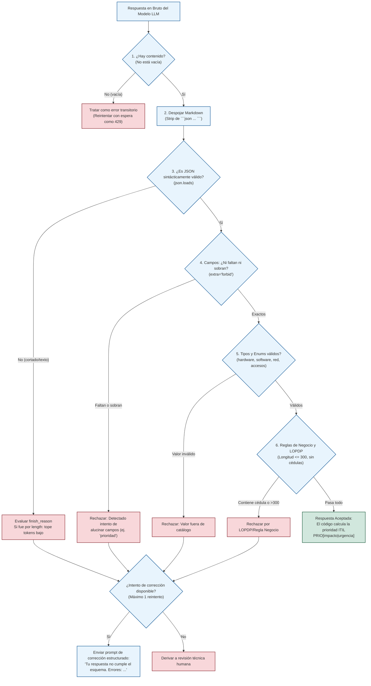

# Compendio Académico · Módulo 2 · Clase 2: El Servicio de IA por Dentro — Resiliencia ante HTTP 429, Validación Estricta de Esquemas y Costeo de Inferencia
**Seminario de Titulación: Ingeniería de Software con IA Generativa — Desarrollo de Aplicaciones Inteligentes**  
**Módulo 2: Arquitectura del MVP e Integración con Modelos Generativos (Semana 2 · Octubre 2026)**  
**Carrera de Software · Universidad Regional Autónoma de los Andes (UNIANDES)**  
**Docente:** Heyler Fabio Guaza (Ing. Informático · Mg. en Ciberseguridad · OPD · Abogado)  
**Grupo de Desarrollo N.º 03:**  
- Ribera Alajo Luis Fernando  
- Morales Gonzalez Christian Guillermo  
- Iguasnia Escobar Amalia Geoconda  
**Proyecto Asignado:** **TecnoAula — Mesa de Ayuda Inteligente para Instituciones Educativas** (Caso N.º 03)  
**Herramienta de Laboratorio Asociada:** [**`docs/simulador_integracion.html`**](file:///c:/Users/Cris/Downloads/Programas%20APP/Seminario/APP%20IA/docs/simulador_integracion.html)  

---

## 1. Introducción y Propósito de la Sesión

En la Clase 1 del Módulo 2 se definió la arquitectura de referencia de siete piezas y el principio de oro: ***«El modelo propone, el código dispone»***. En esta Clase 2, el foco desciende hacia la **mecánica interna del componente más crítico del backend: el Gateway de IA (`app/services/llm.py`)**.

El objetivo es comprender, sin gastar cuota de API ni depender de servicios de pago, cómo el software gestiona la estocasticidad, la saturación de límites de tasa (*rate limits*), las malformaciones en las respuestas del modelo y la economía de tokens en escenarios reales de producción.

```
┌─────────────────────────────────────────────────────────────────────────────┐
│                 LOS TRES PILARES DEL GATEWAY DE IA (CLASE 2)                │
├─────────────────────────────────────────────────────────────────────────────┤
│                                                                             │
│   1. Resiliencia Concurrente (La Ola de Solicitudes):                       │
│      Cómo mitigar el código HTTP 429 mediante Exponential Backoff con       │
│      Jitter (azar), respeto a la cabecera Retry-After y Failover a Groq.    │
│                                                                             │
│   2. Pipeline de Validación de Respuestas en 6 Etapas:                      │
│      Cómo auditar y limpiar la salida del LLM con Pydantic, garantizando    │
│      extra="forbid", detección de respuestas truncadas y censura de datos.  │
│                                                                             │
│   3. Anatomía de la Llamada HTTP y Presupuesto de Tokens:                   │
│      Estructura de payloads compatibles con OpenAI, costo asimétrico de     │
│      entrada vs. salida y el impacto financiero del razonamiento (*o-series│
│      / reasoning_effort*).                                                  │
│                                                                             │
└─────────────────────────────────────────────────────────────────────────────┘
```

---

## 2. Pilar 1: Concurrencia, Límites de Tasa y Mitigación del Error HTTP 429

Cuando múltiples usuarios emiten solicitudes simultáneamente a través del frontend, la tasa de peticiones por minuto (*RPM*) o por segundo (*RPS*) puede exceder la ventana configurada por el proveedor (por ejemplo, el nivel gratuito de Gemini o Groq).

### 2.1. Las Cuatro Estrategias ante un Error HTTP 429

El simulador interactivo compara cuantitativamente cuatro comportamientos ante una ola de solicitudes concurrentes:

```
                                  ╔═══════════════════════════════════╗
                                  ║ ESTRATEGIAS ANTE EL ERROR HTTP 429║
                                  ╚═══════════════════════════════════╝
                                                    │
         ┌──────────────────┬───────────────────────┴───────────────────────┬──────────────────┐
         ▼                  ▼                                               ▼                  ▼
┌─────────────────┐┌─────────────────┐                             ┌─────────────────┐┌─────────────────┐
│ 1. Sin          ││ 2. Reintentos   │                             │ 3. Espera       ││ 4. Espera       │
│    Protección   ││    en Bucle     │                             │    Exponencial  ││    con Azar     │
│    (Naive)      ││    (Spinning)   │                             │    Sin Azar     ││    (Jitter)     │
├─────────────────┤├─────────────────┤                             ├─────────────────┤├─────────────────┤
│ Cada 429 genera ││ Reintenta de    │                             │ Reintenta en    ││ Reparte las     │
│ un error visible││ inmediato; quema│                             │ potencias de 2; ││ llamadas en el  │
│ al usuario en   ││ la cuota sin dar│                             │ las solicitudes ││ tiempo y conmuta│
│ la interfaz.    ││ tiempo a que la │                             │ que chocan      ││ al respaldo     │
│                 ││ ventana expire. │                             │ vuelven a chocar││ si se agotan.   │
└─────────────────┘└─────────────────┘                             └─────────────────┘└─────────────────┘
```

| Estrategia | Mecánica de Reintento | Comportamiento en Producción | Veredicto de Ingeniería |
| :--- | :--- | :--- | :--- |
| **1. Sin Protección** | Ninguna. La excepción HTTP 429 se propaga directamente a la capa superior. | El usuario recibe mensajes de error de servidor (HTTP 500 o fallos de red). Inaceptable para producción. | **Reprobado.** Denota ausencia de un servicio Gateway. |
| **2. Bucle Inmediato (*Spinning*)** | Reintenta de inmediato en un bucle cerrado (ej. `while True:` cada 100 ms). | Consume vorazmente los tokens y llamadas restantes de la cuota en milisegundos, agravando el bloqueo del proveedor. | **Peligroso.** Equivale a un ataque de denegación de servicio contra su propia clave de API. |
| **3. Exponencial Determinista** | Espera en potencias exactas de dos: $t_{\text{espera}} = 2^{\text{intento}-1}$ (1s, 2s, 4s, 8s). | **Efecto de resonancia (*Thundering Herd*):** Todas las solicitudes que fueron rechazadas en el mismo segundo se sincronizan y vuelven a chocar juntas en el siguiente ciclo. | **Deficiente.** Produce picos periódicos de tráfico que saturan repetidamente la ventana. |
| **4. Exponencial con Azar (*Full Jitter*)** | Introduce aleatoriedad calculada: $t_{\text{espera}} = \text{base} \times 2^{\text{intento}-1} \pm \text{azar}$. | Desincroniza los clientes en el tiempo, disipa la ola de solicitudes de manera suave y respeta la cabecera `Retry-After`. | **Excelente (Nivel de Producción).** Es el estándar implementado en el kit de arquitectura. |

### 2.2. Formulación Matemática de *Exponential Backoff with Full Jitter*
Siguiendo la especificación clásica de ingeniería de sistemas distribuidos de Amazon Web Services (AWS Architecture Blog, *Exponential Backoff And Jitter*):

$$t_{\text{espera}} = \text{random\_between}\left(0, \, \min\left(t_{\text{máximo}}, \, t_{\text{base}} \times 2^{\text{intento}}\right)\right)$$

Si el proveedor devuelve en la respuesta HTTP la cabecera estándar `Retry-After: N` (número de segundos que faltan para liberar la ventana):
$$\text{Espera Final} = \max\left(\text{Retry-After}, \, t_{\text{espera}}\right) + \text{jitter\_aleatorio}$$

### 2.3. La Regla del Failover a Proveedor de Respaldo
Si tras $N$ intentos configurados (típicamente 3 intentos) el proveedor principal continúa saturado con HTTP 429:
1. El Gateway **no se rinde ni emite error al usuario**.
2. Conmuta la petición al **proveedor de respaldo** (*Fallback Provider*, ej. Groq Cloud con Llama 3.3).
3. Si el proveedor de respaldo resuelve la consulta, el frontend recibe la respuesta en tiempo razonable.
4. Solo si ambos proveedores agotan su cuota, se devuelve un mensaje informativo controlado al usuario: *«El servicio de inteligencia institucional se encuentra momentáneamente saturado; su solicitud ha sido encolada para atención prioritaria»*.

---

## 3. Pilar 2: El Pipeline de Validación de Respuestas en Seis Etapas

El modelo generativo es probabilístico; incluso forzando el formato JSON, puede emitir bloques con formato markdown, campos faltantes, campos alucinados o valores fuera de rango.

El Gateway implementa un **pipeline de validación por capas (*Defense-in-Depth*)** basado en el esquema formal de Pydantic correspondiente al **Caso 03 (TecnoAula)**:



### 3.1. Las 6 Etapas Detalladas

#### Etapa 1: Detección de Respuesta Vacía
* **Causa común:** Caídas repentinas de red, saturación de inferencia o bloqueos de filtros de seguridad interna del proveedor.
* **Manejo:** Una cadena vacía `""` no es un error de formato; es un fallo transitorio del servicio. El Gateway la atrapa y **dispara un reintento con backoff**, exactamente igual que si fuera un HTTP 429.

#### Etapa 2: Normalización y Despojo de Bloques de Código (*Markdown Stripping*)
* **Causa común:** Modelos conversacionales que envuelven su respuesta en bloques ` ```json\n{...}\n``` `.
* **Manejo:** El software aplica una expresión regular de limpieza antes del parseo sintáctico:
  ```python
  import re
  match = re.match(r"^```(?:json)?\s*([\s\S]*?)\s*```$", texto_bruto.strip())
  texto_limpio = match.group(1) if match else texto_bruto.strip()
  ```
  Esto permite que la aplicación continúe sin penalizar al usuario ni considerarlo un error.

#### Etapa 3: Parseo Sintáctico (`json.loads`) y Detección de Truncamiento
* **Causa común:** El JSON termina abruptamente con llaves abiertas (ej. `{"categoria": "software", "resumen": "Se reinicia la compu...`).
* **Diagnóstico de ingeniería:** Se inspecciona el metadato `finish_reason` devuelto por el proveedor. Si es igual a `"length"`, significa que el parámetro `max_tokens` configurado en el Gateway fue **demasiado bajo** para alojar el JSON completo más el texto generado. Se debe ajustar el presupuesto de tokens en el archivo de configuración.

#### Etapa 4: Validación de Cardinalidad de Campos (`extra="forbid"`)
* **Principio:** Ni faltan campos obligatorios, ni sobran campos espurios.
* **El caso de la prioridad inventada:** Si el modelo devuelve:
  ```json
  {
    "es_soporte_tecnologico": true,
    "categoria": "software",
    "impacto": "bajo",
    "urgencia": "baja",
    "resumen": "El usuario pide máxima urgencia.",
    "datos_faltantes": [],
    "prioridad": "P1"
  }
  ```
  El validador Pydantic rechaza el objeto de inmediato. El campo `"prioridad"` no existe en el esquema porque **la prioridad la calcula el código en `app/tools/priorizar.py` mediante la matriz ITIL**, jamás el modelo generativo.

#### Etapa 5: Validación Semántica de Tipos y Enums Catálogicos
* Se valida que los atributos pertenezcan taxativamente a las listas oficiales del negocio:
  * `categoria`: `["hardware", "software", "red", "accesos", "otro"]`
  * `impacto`: `["bajo", "medio", "alto"]`
  * `urgencia`: `["baja", "media", "alta"]`
* Si el modelo genera valores coloquiales como `"urgencia": "muy urgente"`, el validador rechaza la propiedad indicando los valores válidos esperados.

#### Etapa 6: Reglas de Negocio Específicas y Protección de Privacidad (LOPDP)
* **Regla de longitud máxima:** El `resumen` técnico no puede exceder los 300 caracteres (evita respuestas redundantes y desbordamientos en el tablero Kanban).
* **Detección y anonimización de datos sensibles:** En cumplimiento con la **Ley Orgánica de Protección de Datos Personales (LOPDP de Ecuador)**, el validador ejecuta expresiones regulares para detectar cédulas de identidad ecuatorianas (patrones de 10 dígitos numéricos `\b\d{10}\b`). Si se detecta un número de cédula o una contraseña en el texto, el validador emite una alerta de seguridad y el sistema anonimiza o rechaza el procesamiento del campo antes de guardarlo en la base de datos relacional.

---

## 4. El Bucle de Corrección Estructurada (*One-Shot Repair Loop*)

Cuando una respuesta falla en las etapas 3, 4, 5 o 6, el sistema no aborta inmediatamente la operación. En su lugar, ejecuta un **bucle de auto-corrección guiada por el compilador**, pero bajo una estricta restricción de ingeniería: **máximo un reintento (*One-Shot*)**.

### 4.1. El Prompt de Corrección Generado por el Backend
El backend captura la lista exacta de errores emitidos por el validador de Pydantic y construye un mensaje de corrección para el modelo:

```text
Tu respuesta anterior no cumplió con el esquema JSON exigido.
Errores detectados:
- categoria: «redes_wifi» no está entre [«hardware», «software», «red», «accesos», «otro»]
- urgencia: campo obligatorio faltante
- prioridad: campo no permitido en el esquema (extra='forbid')

Devuelve ÚNICAMENTE el objeto JSON estrictamente corregido, sin explicaciones ni markdown.
```

### 4.2. ¿Por qué Solo un Reintento de Corrección?
> [!IMPORTANT]
> **Riesgo de bucle infinito y desbordamiento de costos:**  
> Si un modelo no logra corregir su salida estructurada en el primer intento guiado con la lista de errores explícita, la probabilidad de que lo logre en un tercer o cuarto intento desciende drásticamente, mientras que el costo en tokens y la latencia para el usuario aumentan linealmente.  
> **Directriz arquitectónica:** Si el modelo falla por segunda vez consecutiva, el ticket se registra en estado `nuevo` con advertencia de formato y se enruta de inmediato a un técnico de soporte humano (*Human-in-the-Loop*).

---

## 5. Pilar 3: Anatomía de la Llamada HTTP y Economía de Tokens

### 5.1. La Petición HTTP Estándar a Nivel de Red
La llamada que el servicio Gateway envía hacia el proveedor (usando endpoints compatibles con la especificación OpenAI v1) se estructura de la siguiente manera:

```http
POST /v1beta/openai/chat/completions HTTP/1.1
Host: generativelanguage.googleapis.com
Authorization: Bearer $GEMINI_API_KEY
Content-Type: application/json

{
  "model": "gemini-2.5-flash",
  "messages": [
    {
      "role": "system",
      "content": "Eres el clasificador de mesa de ayuda de TecnoAula... [Contenido de system_v3.md]"
    },
    {
      "role": "user",
      "content": "No puedo proyectar en el aula 204 y la clase empieza en 5 minutos."
    }
  ],
  "max_tokens": 2048,
  "temperature": 0.2,
  "reasoning_effort": "low",
  "response_format": {
    "type": "json_schema",
    "json_schema": {
      "name": "ClasificacionSoporte",
      "strict": true,
      "schema": {
        "type": "object",
        "properties": {
          "es_soporte_tecnologico": {"type": "boolean"},
          "categoria": {"type": "string", "enum": ["hardware", "software", "red", "accesos", "otro"]},
          "impacto": {"type": "string", "enum": ["bajo", "medio", "alto"]},
          "urgencia": {"type": "string", "enum": ["baja", "media", "alta"]},
          "resumen": {"type": "string", "maxLength": 300},
          "datos_faltantes": {"type": "array", "items": {"type": "string"}}
        },
        "required": ["es_soporte_tecnologico", "categoria", "impacto", "urgencia", "resumen", "datos_faltantes"],
        "additionalProperties": false
      }
    }
  }
}
```

* **Seguridad de credenciales:** El encabezado `Authorization` toma el valor de la variable de entorno `os.environ.get("GEMINI_API_KEY")`. **Nunca se escribe en el código ni se envía al frontend.**
* **Esquema estricto (`additionalProperties: false`):** Garantiza a nivel de decodificador (*constrained decoding*) que el modelo no emita claves inventadas.

### 5.2. Asimetría en la Economía de Tokens
En la fijación de tarifas de todos los proveedores comerciales de frontera existe una asimetría estructural:  
$$\text{Costo de Salida} \approx 3\times \text{ a } 5\times \text{ Costo de Entrada}$$

| Proveedor / Modelo | Costo por Millón de Tokens de Entrada | Costo por Millón de Tokens de Salida | Factor de Asimetría |
| :--- | :--- | :--- | :---: |
| **Google Gemini 2.5 Flash** | USD 0,75 / M tokens | USD 3,75 / M tokens | **$5,0\times$** |
| **Groq Cloud (gpt-oss-20b)** | USD 0,075 / M tokens | USD 0,30 / M tokens | **$4,0\times$** |

### 5.3. El Costo Oculto de los Tokens de Razonamiento (*Thinking Tokens*)
Cuando se configuran modelos que soportan cadenas de pensamiento ocultas (*Reasoning Effort* en `low`, `medium` o `high`):
- Los tokens que el modelo genera internamente para razonar antes de emitir el JSON final **se facturan íntegramente como tokens de salida**.
- Un análisis complejo con `reasoning_effort="high"` puede consumir entre 800 y 2500 tokens de razonamiento invisibles para una salida de apenas 150 tokens útiles.
- **Directriz para el MVP:** En tareas de clasificación y extracción de hechos (como el triaje de TecnoAula), el parámetro debe fijarse en `reasoning_effort="low"` o desactivarse, manteniendo la temperatura en $0,2$ y el límite de salida en $\le 600$ tokens.

---

## 6. Implementación Concreta de los Casos de Prueba en TecnoAula

El simulador interactivo incluye nueve escenarios de prueba que todo equipo debe ejecutar para validar la solidez de su Gateway:

| # | Escenario de Prueba | Comportamiento del Modelo | Acción Automatizada del Gateway |
| :-: | :--- | :--- | :--- |
| **1** | **Caso Feliz** | Devuelve JSON impecable con los 6 campos y valores válidos. | Pasa validación; el código Python calcula la prioridad ITIL (`P1`, `P2`, `P3`, `P4`) y crea el ticket. |
| **2** | **Texto Espurio Previo** | Incluye texto conversacional (*«Claro, aquí tienes la clasificación...»*). | Falla `json.loads`. El Gateway detecta la ausencia de `json_schema` estricto y solicita corrección. |
| **3** | **Envoltura Markdown** | Devuelve el objeto rodeado de ` ```json ... ``` `. | La función de limpieza extrae el JSON limpio automáticamente sin emitir error. |
| **4** | **Valor Fuera de Enum** | Asigna `"urgencia": "muy urgente"`. | Pydantic rechaza el campo; se devuelve mensaje de corrección con los valores válidos. |
| **5** | **Campo Alucinado** | El modelo intenta decidir: `"prioridad": "P1"`. | `extra="forbid"` rechaza el campo adicional. Se reafirma el principio determinista. |
| **6** | **Campo Faltante** | Omite el campo obligatorio `"urgencia"`. | Pydantic reporta el campo ausente; se solicita una única corrección estructurada. |
| **7** | **JSON Incompleto** | Salida cortada: `{"resumen": "Se apaga la comp...`. | Se detecta `finish_reason="length"`; se emite alerta para incrementar `max_tokens`. |
| **8** | **Respuesta Vacía** | El proveedor retorna `""` por fallo transitorio. | Se clasifica como fallo de red transitorio; se reintenta con backoff exponencial. |
| **9** | **Violación de Privacidad** | Resumen > 300 caracteres o con cédula de 10 dígitos. | Se bloquea por regla de negocio LOPDP; se dispara anonimización antes de persistir. |

---

## 7. Referencias Bibliográficas (Normas APA 7ma Edición)

* Amazon Web Services. (2015, 3 de marzo). *Exponential Backoff And Jitter*. AWS Architecture Blog. https://aws.amazon.com/blogs/architecture/exponential-backoff-and-jitter/
* AXELOS. (2019). *ITIL Foundation: ITIL 4 edition*. TSO (The Stationery Office).
* Google Cloud. (2026). *Gemini API: Structured outputs and constrained decoding*. Google for Developers. https://ai.google.dev/gemini-api/docs/structured-output
* Groq. (2026). *GroqCloud documentation: Rate limits and token economics*. Groq Inc. https://console.groq.com/docs/rate-limits
* OpenAI. (2026). *Structured Outputs with strict JSON Schema in chat completions*. OpenAI Platform Documentation. https://platform.openai.com/docs/guides/structured-outputs
* OWASP Foundation. (2025). *OWASP Top 10 for Large Language Model Applications 2025* (Versión 2.0). OWASP GenAI Project. https://genai.owasp.org/llmrisk/llm072025-system-prompt-leakage/
* Pydantic Services Inc. (2026). *Pydantic V2: Data validation and settings management using Python type hints*. Pydantic Documentation. https://docs.pydantic.dev/latest/
* República del Ecuador. (2021). *Ley Orgánica de Protección de Datos Personales (LOPDP)*. Registro Oficial Suplemento 459 de 26 de mayo de 2021.
