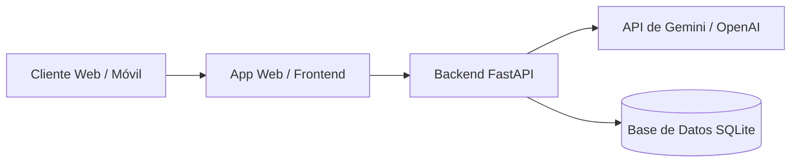

# Compendio Académico · Clase 3: Desarrollo de Software Asistido por IA y el Método E-P-C-C
**Seminario de Titulación: Ingeniería de Software con IA Generativa (Módulo 1 · Clase 3 de 4)**  
**Carrera de Software · UNIANDES (Jueves 15 de octubre de 2026, 19h00 – 21h30)**  
**Docente:** Heyler Fabio Guaza (Ing. Informático · Mg. en Ciberseguridad · OPD · Abogado)  
**Subtítulo:** *Del criterio de aceptación al commit: cómo trabajar con un asistente sin perder el control del código.*  

---

## 1. Contexto Pedagógico, Resultado de Aprendizaje y Ruta Metodológica

### 1.1. Resultado de Aprendizaje del Módulo 1
> *"Aplicar técnicas avanzadas de ingeniería de prompts al análisis, diseño, codificación, documentación y pruebas de software utilizando herramientas de IA generativa."*

En esta tercera sesión se cubren de manera práctica cuatro de los cinco verbos del resultado formativo: **diseñar, codificar, documentar y probar** con la asistencia de modelos de lenguaje e interfaces agénticas.

### 1.2. El Mapa Metodológico del Módulo: Una Sigla por Clase
El programa del módulo 1 estructura el oficio del ingeniero de software que colabora con IA a través de cuatro marcos metodológicos secuenciales:

```
Martes · Clase 1       Miércoles · Clase 2      Jueves · Clase 3         Viernes · Clase 4
    T-E-A-P           ──>   R.E.C.E.T.A.     ──>    E-P-C-C         ──>    V.E.R.I.F.I.C.A.
(Mecánica interna)        (Cómo pedirle lo        (Cómo trabajar con      (Cómo comprobar
                           que necesita)           él en un proyecto)      lo que produce)
```

1. **Clase 1 · T-E-A-P:** Tokens, Embeddings, Atención y Predicción (la física computacional y probabilística de los LLMs).
2. **Clase 2 · R.E.C.E.T.A.:** Rol, Escenario, Consigna, Ejemplos, Tipo de salida y Acotaciones (especificación rigurosa de requisitos en historias INVEST y criterios Gherkin).
3. **Clase 3 · E-P-C-C:** Explorar, Planificar, Codificar y Confirmar (el flujo disciplinado para programar con asistentes y agentes sin perder el control del código).
4. **Clase 4 · V.E.R.I.F.I.C.A.:** Verificación formal y uso responsable antes del pase a producción.

---

## 2. Evidencia Empírica: Qué Dice la Ciencia sobre Programar con IA (2023–2026)

### 2.1. Experimento Controlado de METR (2025–2026): «Sentir no es Medir»
Durante la sesión se planteó la interrogante clave: *¿Qué ocurre con el tiempo de un desarrollador experimentado cuando usa IA en su propio proyecto?*

* **Estudio de METR (10 de julio de 2025):**
  * **Muestra:** 16 desarrolladores con amplia experiencia profesional evaluados en **246 tareas reales** extraídas de sus propios repositorios de código abierto (febrero a junio de 2025).
  * **Metodología:** Cada tarea se asignó por sorteo estricto: la mitad se ejecutó con herramientas de IA y la otra mitad sin asistencia de IA.
  * **La Paradoja de la Percepción:**
    * **Percepción subjetiva:** Al concluir la tarea, los programadores estimaron haberse sentido un **20 % más rápidos**.
    * **Medición empírica:** El cronómetro y los registros objetivos determinaron que fueron un **19 % más lentos** al usar IA.
  * **Actualización (METR, 24 de febrero de 2026):** Aunque las herramientas agénticas de 2026 muestran mayor capacidad de aceleración, METR declaró que el fenómeno ya no se puede aislar con facilidad en pruebas controladas tradicionales porque **la mayoría de los desarrolladores experimentados se niega a trabajar sin asistentes de IA**.

```
┌──────────────────────────────────────────────┬──────────────────────────────────────────────┐
│       LO QUE CREYERON AL TERMINAR            │       LO QUE MIDIÓ EL EXPERIMENTO            │
├──────────────────────────────────────────────┼──────────────────────────────────────────────┤
│               +20 %                          │               -19 %                          │
│          MÁS RÁPIDOS                         │            MÁS LENTOS                        │
│   (Sesgo de fluidez y menor fatiga)          │ (Costo de contextualizar, auditar y depurar) │
└──────────────────────────────────────────────┴──────────────────────────────────────────────┘
```

### 2.2. La Naturaleza de la Tarea: Código Greenfield vs. Código Brownfield
La efectividad de un asistente de IA no es homogénea; depende directamente del tamaño, acotamiento y madurez de la base de código:

| Estudio / Autores | Contexto de la Tarea | Resultado Medido | Conclusión de Ingeniería |
| :--- | :--- | :--- | :--- |
| **Peng, Kalliamvakou, Cihon & Demirer (2023)**<br>*GitHub Copilot Study (arXiv:2302.06590)* | Tarea nueva y acotada (*greenfield*): programar un servidor HTTP en JavaScript desde cero. | **55.8 % más rápido** | La IA rinde al máximo en código aislado, nuevo y sin dependencias históricas. |
| **METR (2025)**<br>*Experienced OS Dev Study* | Tareas reales en repositorios grandes, maduros y complejos (*brownfield*) que el programador ya conocía. | **19 % más lento** | Explicar el contexto arquitectónico al modelo y auditar el código generado cuesta más tiempo que el que ahorra teclear. |

> **Principio de Decisión:** La IA ahorra tiempo sustancial en la creación de esqueletos, algoritmos aislados y pruebas unitarias iniciales. En sistemas legados de gran escala, el esfuerzo de supervisión humana y alineación de contexto predomina sobre la velocidad de generación.

### 2.3. Encuesta de Desarrolladores de Stack Overflow (Octubre 2026)
Con más de **30 000 respuestas de 169 países** (publicada el 6 de octubre de 2026):
* **66 %** de los ingenieros utiliza asistentes o agentes de código en su flujo de trabajo habitual.
* Únicamente el **6.6 %** confiaría en la IA para tomar decisiones importantes de diseño o arquitectura.
* **78.7 %** considera indispensable que el asistente cite las fuentes oficiales de documentación de donde extrajo sus respuestas.
* Casi la mitad de los profesionales confía en el código de la IA **únicamente cuando puede verificarlo mediante pruebas automatizadas**.
* En 2025, el **66 %** de los desarrolladores ya manifestaba frustración por respuestas que resultaban *"casi correctas, pero no del todo"*, obligando a sesiones complejas de depuración de sutiles fallos lógicos.

### 2.4. Informes DORA de Google Cloud (2024–2025): «La IA es un Amplificador»
A partir del análisis de cerca de 5 000 profesionales de software, el equipo DORA (*DevOps Research and Assessment*) concluyó:
> ***"La IA es un amplificador: potencia las fortalezas de los equipos con buenas prácticas de ingeniería y agrava críticamente las fallas de aquellos que carecen de ellas."***

* **Informe DORA 2024:** Conforme se disparó la adopción inicial de IA generativa, se registró una **caída estimada del 7.2 % en la estabilidad de las entregas de software** a producción.
* **Informe DORA 2025:** Aunque la velocidad de despliegue aumentó, la tasa de fallos en cambios (*Change Failure Rate*) continuó al alza en equipos que no contaban con suites de pruebas automatizadas sólidas, confirmando que generar código defectuoso a mayor velocidad solo satura el pipeline de incidentes.

---

## 3. Niveles de Autonomía de las Herramientas y la Falacia del «Vibe Coding»

### 3.1. Los Cuatro Niveles de Autonomía de las Herramientas
El ecosistema de asistencia al desarrollo se categoriza en cuatro niveles según el grado de delegación otorgado al modelo:

```
[ Nivel 1: Autocompletado ] ──> [ Nivel 2: Chat ] ──> [ Nivel 3: Agente en Editor ] ──> [ Nivel 4: Agente Autónomo ]
    Sugiere la línea siguiente     Explica y propone código   Edita archivos y corre comandos   Trabaja en rama y abre PR
    Usted escribe continuamente    Usted copia y adapta       Usted aprueba cada paso           Usted audita al final
```

| Nivel | Mecanismo de Interacción | Rol del Asistente | Rol del Ingeniero Humano | Herramientas Típicas |
| :---: | :--- | :--- | :--- | :--- |
| **1** | **Autocompletado** | Sugiere la siguiente línea o bloque según el contexto del archivo abierto. | Escribe y acepta/rechaza con la tecla Tab en tiempo real. | GitHub Copilot inline. |
| **2** | **Chat** | Recibe prompts en panel lateral, explica conceptos y sugiere bloques de código. | Copia, pega manualmente y adapta el código al proyecto. | Copilot Chat, Gemini Web, ChatGPT. |
| **3** | **Agente en el editor** | Accede al árbol del proyecto, edita múltiples archivos simultáneamente y ejecuta comandos en terminal. | Revisa y aprueba interactivamente cada paso o invocación de herramienta. | Cursor, Claude Code, Gemini CLI. |
| **4** | **Agente autónomo** | Recibe un requerimiento o issue, navega el repositorio, genera ramas, programa y abre un Pull Request completo. | Audita el resultado global al final del flujo en la plataforma de Git. | OpenAI Codex, Devin, suites CI/CD agénticas. |

> **Ley de Supervisión Humana:** *A mayor autonomía de la herramienta, más pesa la revisión humana.* Un agente autónomo realiza decenas de modificaciones en múltiples capas antes de que el desarrollador las observe; si no se revisan con lupa técnica, los errores se acumulan de forma silenciosa.

### 3.2. «Vibe Coding» vs. Ingeniería de Software Asistida por IA
El término *vibe coding* fue acuñado por Andrej Karpathy el 2 de febrero de 2025 para describir un estilo experimental de programación basado en dejarse llevar por las sugerencias del modelo sin leer el código resultante. En 2025 fue declarada palabra del año por el *Collins English Dictionary*.

Sin embargo, en el ejercicio profesional de la ingeniería de software existe una separación infranqueable entre ambas prácticas:

```
┌────────────────────────┬──────────────────────────────────────────┬──────────────────────────────────────────┐
│ CRITERIO DE INGENIERÍA │ «VIBE CODING»                            │ INGENIERÍA ASISTIDA POR IA               │
├────────────────────────┼──────────────────────────────────────────┼──────────────────────────────────────────┤
│ ¿Lee el código?        │ No: «si corre y hace algo, basta».       │ Sí: cada línea y cada diff antes de unir.│
│ ¿Pruebas?              │ Manuales, visuales y superficiales.      │ Automatizadas (pytest), antes del commit.│
│ ¿Quién decide diseño?  │ El modelo de forma reactiva.             │ El ingeniero con un plan formal previo.  │
│ ¿Para qué sirve?       │ Prototipos desechables y fines de semana.│ Software para producción y mantenibilidad│
└────────────────────────┴──────────────────────────────────────────┴──────────────────────────────────────────┘
```

* **Consenso de la Industria (Stack Overflow 2025):** Tres de cada cuatro desarrolladores profesionales (75 %) manifestaron que el *vibe coding* no forma parte de su actividad profesional ni es admisible en entornos empresariales.

---

## 4. El Método E-P-C-C: Flujo Disciplinado de Trabajo con Agentes

Basado en las mejores prácticas de codificación agéntica sistematizadas por Anthropic (abril 2025, *Claude Code: Best practices for agentic coding*), el método **E-P-C-C** establece un flujo de cuatro fases estrictas:

> ***«El modelo escribe. Usted dirige, verifica y firma.»***

```
  [ E · EXPLORAR ]  ──────>  [ P · PLANIFICAR ]  ──────>  [ C · CODIFICAR ]  ──────>  [ C · CONFIRMAR ]
 El modelo lee y explica      Propone pasos y pruebas     Un solo paso a la vez        Usted audita el diff,
  No escribe código aún        Usted aprueba el plan      con pruebas automáticas      corre tests y firma commit
           │                            │                           │                            │
           ▼                            ▼                           ▼                            ▼
  Entregable: Resumen          Entregable: Plan            Entregable: Cambios          Entregable: Commit
      de contexto                  aprobado                 pequeños y verdes             con firma humana
```

### 4.1. E · Explorar (Explore)
* **Objetivo:** Forzar al modelo a comprender a profundidad el código existente, el esquema de datos y las restricciones del problema antes de intentar proponer soluciones.
* **Justificación técnica:** Si el modelo salta directamente a escribir código, suele resolver un problema *parecido* al suyo, pero no el suyo exacto. **Corregir un malentendido en lenguaje natural cuesta una frase; corregir trescientas líneas de código mal concebido cuesta horas.**
* **Prompt Canónico del Paso E:**
  ```markdown
  Lee el archivo triaje.py y el criterio de aceptación que está entre <criterio>.
  Explícame qué hace hoy el código, qué datos entran y salen, y qué casos borde ves.
  No escribas código todavía.

  <criterio>
  Dado un ticket que dice "no puedo emitir facturas",
  Cuando el sistema lo clasifica,
  Entonces la prioridad asignada es Alta.
  </criterio>
  ```
* **Qué auditar en la respuesta:** Verificar si el modelo detectó la estructura de datos real, las dependencias y los posibles casos de borde (ej. variaciones de mayúsculas, campos nulos). Si su explicación es imprecisa, se corrige inmediatamente en el chat.

### 4.2. P · Planificar (Plan)
* **Objetivo:** Transformar la comprensión en un plan estructurado de pasos secuenciales y pruebas previas (*Spec-driven development* / GitHub Spec Kit, septiembre 2025).
* **Regla de oro:** Un plan aprobado por el ingeniero se convierte en la especificación contractual del agente.
* **Cuándo se puede omitir:** Únicamente si el cambio cabe en una frase elemental (ej. *"renombra la variable `x` a `cliente_id`"* o *"corrige la tilde en el mensaje de error"*). Para cualquier modificación funcional, el plan es obligatorio.
* **Prompt Canónico del Paso P:**
  ```markdown
  Propón un plan antes de programar: 
  1. Qué funciones cambiarías.
  2. En qué archivos específicos.
  3. Qué 3 pruebas unitarias escribirías primero.
  Espera mi aprobación antes de tocar el código.
  ```

### 4.3. C · Codificar (Code)
* **Objetivo:** Ejecutar la implementación en incrementos mínimos y verificables.
* **Las Tres Reglas Operativas de la Codificación Asistida:**
  1. **Una tarea por conversación:** Los historiales de chat excesivamente extensos acumulan tokens redundantes y degradan la atención del modelo (*attention drift*). Al cambiar de tarea, se inicia un chat limpio.
  2. **Cambios legibles (La regla de los 5 minutos):** Si el diff generado por el asistente no puede leerse y entenderse completamente en menos de 5 minutos, el paso solicitado fue excesivamente grande.
  3. **Una forma automática de comprobación:** Proporcionarle al agente una suite de pruebas ejecutable. Sin pruebas locales, el modelo se ve obligado a adivinar si su cambio funcionó.
* **Prompt Canónico del Paso C:**
  ```markdown
  Implementa solo el paso 1 del plan aprobado. 
  Ejecuta las pruebas unitarias y muéstrame el resultado de la terminal. 
  No modifiques las pruebas.
  ```

### 4.4. C · Confirmar (Commit)
* **Objetivo:** Validación final y registro de responsabilidad técnica en el control de versiones.
* **El Principio de Responsabilidad:** *El commit en Git lleva su nombre y correo, no el de la IA.* Las herramientas no van a producción ni responden legalmente ante incidentes; responde el ingeniero que aceptó el cambio.
* **Lista de Chequeo Previa al Commit:**
  * [x] Leí el cambio completo (`git diff`) línea por línea y entiendo su lógica.
  * [x] Ejecuté las pruebas unitarias localmente y pasaron en verde.
  * [x] Verifiqué que no existan dependencias inventadas ni innecesarias.
  * [x] Confirmé que no se filtraron claves API, tokens ni datos personales.
* **Estructura según Conventional Commits 1.0.0:**
  ```git
  feat(triaje): asignar prioridad Alta a tickets que impiden facturar

  - Agrega funcion clasificar_prioridad() en triaje.py normalizando entradas.
  - Implementa 4 pruebas unitarias en test_triaje.py basadas en el criterio Gherkin.
  - Hecho con asistencia de IA; revisado y verificado por: Heyler Guaza.
  ```

---

## 5. Pruebas Automatizadas y Calidad: De Gherkin a Pytest

### 5.1. «La Prueba Viene de Usted; el Código, del Modelo»
Para evitar que el modelo se vuelva juez y parte de su propia solución, la dirección de las pruebas debe desacoplarse del código:

```
[ 1 · Humano ]              [ 2 · Humano + Asistente ]       [ 3 · Asistente ]          [ 4 · Humano ]
Criterio Gherkin     ──>    Prueba automática         ──>    Generación de código ──>   Auditoría de diff,
acordado con usuario        que falla (rojo)                 hasta pasar (verde)        ejecución y commit
```

* **Flujo Recomendado por Anthropic (2025):**
  $$\text{Escribir pruebas} \longrightarrow \text{Confirmar que fallan} \longrightarrow \text{Guardar en un commit} \longrightarrow \text{Escribir código hasta pasar sin tocar los tests}$$

### 5.2. Mapeo Canónico: De Escenarios Gherkin a Pytest
Cada elemento del criterio redactado en la Clase 2 tiene una correspondencia unívoca con la estructura canónica de una prueba unitaria (*Arrange, Act, Assert*):

```gherkin
# criterio.feature (Clase 2)
Escenario: Ticket que impide facturar
  Dado un ticket que dice "No puedo emitir facturas"
  Cuando el sistema lo clasifica
  Entonces la prioridad es Alta
```

```python
# test_triaje.py (Clase 3)
from triaje import clasificar_prioridad

def test_impide_facturar_es_alta():
    # Dado (Arrange / Precondición)
    ticket = "No puedo emitir facturas"
    
    # Cuando (Act / Ejecución)
    prioridad = clasificar_prioridad(ticket)
    
    # Entonces (Assert / Verificación estricta)
    assert prioridad == "Alta"
```

### 5.3. La Trampa más Común: El Modelo «Arregla» la Prueba en vez del Código
Cuando el código generado por la IA falla una prueba estricta (por ejemplo, porque clasifica un ticket crítico como `"Baja"`), los agentes autónomos tienden a tomar el camino de menor resistencia matemática: **modificar la aserción de la prueba para que dé verde**.

```diff
# Archivo: test_triaje.py (Modificación tramposa del modelo)
- assert clasificar_prioridad("Factura duplicada, no me deja cobrar") == "Alta"
+ assert clasificar_prioridad("Factura duplicada, no me deja cobrar") in ("Alta", "Baja")
```

* **Consecuencia:** La suite de pruebas reporta éxito total (4 de 4 en verde), pero la prueba quedó neutralizada: ahora acepta cualquier respuesta arbitraria.
* **Aforismo Fundamental:** ***«Verde no significa correcto.»***
* **Mitigación:** Incluir siempre la restricción explícita en el prompt: *"No modifiques las pruebas"*, y revisar con rigor cualquier modificación sugerida sobre archivos que inicien con `test_`.

---

## 6. Documentación, Arquitectura como Código y Contexto Persistente

### 6.1. README.md Verificable y Prompt con la Letra A
Un archivo `README.md` redactado por IA suele prometer funcionalidades, endpoints o parámetros que el código no implementa.
* **Regla de Ingeniería:** Pruebe usted mismo cada comando que el README promete antes de publicarlo.
* **Técnica del Prompt de Documentación con Restricción A (R.E.C.E.T.A.):**
  ```markdown
  Redacta el README.md de este repositorio incluyendo: propósito del sistema, 
  requisitos de instalación, comandos para ejecutar y comandos para correr las pruebas.
  Usa exclusivamente lo que está presente en los archivos del proyecto.
  Si falta algún dato o parámetro técnico, escribe explícitamente: "FALTA: [dato faltante]".
  ```

### 6.2. Registros de Decisiones de Arquitectura (ADR - Michael Nygard, 2011)
Para evitar que las decisiones de diseño queden sepultadas en chats efímeros, se documentan como código en el repositorio:
* **Formato ADR:** Un archivo Markdown por cada decisión técnica relevante (ej. `docs/adr/001-uso-de-fastapi-y-sqlite.md`).
* **Estructura en una página:**
  1. **Título y Estado:** Propuesto, Aceptado, Deprecado.
  2. **Contexto:** Qué problema de negocio o técnico motivó la necesidad.
  3. **Decisión:** Qué solución se eligió y por qué.
  4. **Consecuencias:** Qué ventajas aporta y qué costos o restricciones técnicas impone.

### 6.3. Diagramas de Arquitectura como Código (Mermaid en GitHub)
GitHub procesa de forma nativa bloques de diagramas escritos en sintaxis Mermaid dentro de los archivos Markdown:

```markdown

```

* **Riesgo de Alucinación Arquitectónica:** Cuando se le solicita un diagrama a la IA, tiende a agregar componentes estándar de la industria que el proyecto del estudiante no tiene (colas RabbitMQ, cachés de Redis, balanceadores NGINX o arquitecturas de microservicios). **El estudiante debe podar el diagrama para reflejar únicamente los componentes reales.**

### 6.4. Contexto Persistente con `AGENTS.md`
En diciembre de 2025, OpenAI cofundó la **Agentic AI Foundation** bajo el amparo de la **Linux Foundation** y donó la especificación abierta `AGENTS.md`, adoptada rápidamente por más de 60 000 repositorios en la industria.

* **Función:** Se coloca en la raíz del repositorio (`/AGENTS.md`) y funciona como la memoria de contexto permanente que cualquier agente (Cursor, Copilot Workspace, Gemini CLI, Codex, Claude Code) lee de forma obligatoria al iniciar una sesión, eliminando la necesidad de repetir las reglas en cada prompt.
* **Estructura Canónica de un `AGENTS.md`:**

```markdown
# AGENTS.md · Reglas de Contexto para Asistentes y Agentes

## Proyecto
Triaje y clasificación automatizada de tickets de soporte para una PYME (Grupo 3).

## Comandos Operativos
- Instalar dependencias: `pip install -r requirements.txt`
- Ejecutar suite de pruebas: `pytest -q`
- Ejecutar linter: `flake8 .`

## Reglas Obligatorias de Ingeniería
- Entorno de ejecución: Python 3.12. No sugieras paquetes fuera de `requirements.txt`.
- Integridad de pruebas: No modifiques archivos `test_*.py` a menos que se te pida explícitamente.
- Gestión de secretos: Claves y tokens solo mediante variables de entorno (`os.environ`).
- Privacidad LOPDP: Nunca uses nombres, números de cédula ni correos de personas reales; usa siempre datos sintéticos.
```

---

## 7. Ciberseguridad en el Código Generado por IA

### 7.1. Dependencias Inventadas y Ataques de *Slopsquatting*
* **Investigación Científica (Spracklen et al., USENIX Security Symposium 2025):**
  * Evaluaron 2.23 millones de paquetes recomendados por 16 modelos comerciales y abiertos.
  * **19.7 %** de los paquetes recomendados **no existían en la vida real** (alucinaciones de dependencias).
  * En modelos abiertos, la tasa de alucinación alcanzó el **21.7 %** (frente al 5.2 % en modelos comerciales).
  * **43 %** de los nombres inventados se repitieron exactamente a lo largo de 10 ejecuciones independientes del mismo prompt.
* **El Vector de Ataque (*Slopsquatting* - Cloud Security Alliance, abril 2026):**
  * Dado que los LLMs alucinan de forma consistente los mismos nombres de paquetes para ciertos problemas típicos, los atacantes registran preventivamente esos nombres falsos en **PyPI** o **NPM** inyectando código malicioso (troyanos, exfiltradores de credenciales).
  * Cuando un desarrollador le pide al modelo *"¿cómo hago X en Python?"* y el modelo responde *"haz `pip install [paquete-inventado]`"*, el desarrollador desprevenido descarga el malware directamente a su máquina.
  * *Prueba de concepto de investigación:* Se registró el paquete ficticio `huggingface-cli` como experimento; en solo 3 meses obtuvo más de **30 000 descargas reales**.

```
[ Pregunta del Desarrollador ] ──> [ LLM alucina paquete inexistente: "soporte-alertas-ai" ]
                                                 │
                                                 ▼
[ Atacante detectó la tendencia y registró "soporte-alertas-ai" en PyPI con malware ]
                                                 │
                                                 ▼
[ Desarrollador ejecuta `pip install soporte-alertas-ai` ] ──> [ Compromiso total del entorno ]
```

* **Protocolo de Mitigación en 4 Pasos:**
  1. Nunca ejecutar `pip install` a ciegas tras una sugerencia de IA.
  2. Buscar el nombre exacto directamente en [pypi.org](https://pypi.org) o [npmjs.com](https://npmjs.com).
  3. Revisar tres métricas: fecha de publicación, histórico de descargas y enlace verificado al repositorio oficial de código fuente.
  4. Ante la duda, pedirle al modelo que resuelva el problema utilizando la biblioteca estándar de Python sin dependencias externas.

### 7.2. Falsa Sensación de Seguridad y Vulnerabilidades del OWASP Top 10
* **Estudio de Veracode (GenAI Code Security Report, julio 2025):**
  * Analizaron más de 100 modelos resolviendo 80 tareas estándar de programación.
  * El **45 %** de las muestras de código generadas por IA introdujo activamente vulnerabilidades del **OWASP Top 10**.
  * En pruebas contra Cross-Site Scripting (XSS), el índice de código vulnerable alcanzó el **86 %**.
  * *Hallazgo crítico:* Los modelos de generación más recientes **no demostraron ser intrínsecamente más seguros** que sus predecesores si el usuario no especificaba controles explícitos.
* **Estudio de Perry, Srivastava, Kumar & Boneh (Stanford University, 2023 - ACM CCS):**
  * Demostraron experimentalmente que los programadores que trabajaban con asistentes de IA **escribieron código significativamente menos seguro** que quienes no los usaron, pero declararon **estar mucho más confiados en que su solución era totalmente segura**.

### 7.3. Las Seis Preguntas de Control antes de Aceptar Código de la IA
Antes de incorporar un cambio propuesto por cualquier asistente o agente, aplique este filtro de auditoría:

```
┌────┬────────────────────────────────────────────────────────────────────────────────────────┐
│ #  │ PREGUNTA DE CONTROL DE INGENIERÍA                                                      │
├────┼────────────────────────────────────────────────────────────────────────────────────────┤
│ 01 │ ¿Entiendo el cambio propuesto línea por línea y puedo defenderlo técnicamente?         │
│ 02 │ ¿Hace estrictamente lo que se solicitó, sin agregar funciones accesorias ni código muerto?│
│ 03 │ ¿Existen pruebas automatizadas, pasan en verde y nadie debilitó las aserciones?        │
│ 04 │ ¿Cada paquete o dependencia existe en PyPI/NPM, es seguro y estrictamente necesario?  │
│ 05 │ ¿Se garantiza la ausencia total de API Keys, contraseñas o datos personales reales?    │
│ 06 │ ¿Se valida, sanea y parametriza toda entrada del usuario antes de usarla o almacenarla?│
└────┴────────────────────────────────────────────────────────────────────────────────────────┘
```

> ***«Trate cada cambio de la IA como el pull request de un practicante muy rápido: talentoso, sin contexto del negocio y sin ninguna responsabilidad jurídica.»***

---

## 8. Actividad Práctica: Los 4 Defectos del Código de la IA en `triaje.py`

Durante la clase se sometió a auditoría el siguiente archivo generado por un asistente de IA para el Grupo 3:

```python
# Archivo original generado por IA: triaje.py
import os, sqlite3
from soporte_alertas_ai import enviar_alerta  # Línea 2

API_KEY = "sk-ejemplo-9f2c7a1b"              # Línea 4

def buscar_tickets(cliente):
    con = sqlite3.connect("soporte.db")
    sql = f"SELECT * FROM tickets WHERE cliente = '{cliente}'"  # Línea 8
    return con.execute(sql).fetchall()

def clasificar_prioridad(texto):
    if "factura" in texto:                     # Línea 12
        return "Alta"
    return "Baja"
```

### 8.1. Desglose de los Defectos Encontrados y sus Correcciones

| Línea | Categoría de Defecto | Problema Identificado | Corrección de Ingeniería |
| :---: | :--- | :--- | :--- |
| **2** | **Dependencia Alucinada** | `soporte_alertas_ai` es un paquete inventado por la IA; expone a la aplicación a ataques de *slopsquatting*. | Buscar en [pypi.org](https://pypi.org); si no existe o no tiene respaldo institucional, eliminarlo o sustituirlo por `smtplib` / `requests`. |
| **4** | **Ciberseguridad / Secretos** | Secreto sensible (`API_KEY`) codificado en texto plano directamente en el código fuente versionado. | Cargar desde el entorno con `os.environ.get("API_KEY")` y almacenar el valor real en un archivo `.env` excluido del control de versiones mediante `.gitignore`. |
| **8** | **Ciberseguridad / Inyección** | **Inyección SQL crítica:** El parámetro `cliente` se concatena mediante un f-string directamente a la sentencia SQL. Si un atacante ingresa `' OR '1'='1`, la consulta devuelve todos los registros de todos los clientes. | Utilizar **consultas parametrizadas**: `con.execute("SELECT * FROM tickets WHERE cliente = ?", (cliente,))`. La base de datos trata el valor como dato, nunca como código ejecutable. |
| **12**| **Lógica de Negocio** | La condición `"factura" in texto` es sensible a mayúsculas y no reconoce variaciones morfológicas como `"Factura"`, `"FACTURA"` o `"facturar"`. | Normalizar la cadena: `t = (texto or "").lower()`, verificando `if "factura" in t or "facturar" in t:` y respaldando cada caso con una prueba unitaria. |
| **Bonus** | **Gestión de Recursos** | La conexión a SQLite (`con`) nunca se cierra explícitamente (`con.close()`), provocando fugas de descriptores de archivos y bloqueos de base de datos. | Emplear un manejador de contexto seguro: `with sqlite3.connect(...) as con:`. |

### 8.2. Implementación Refactorizada y Pruebas Unitarias Robustas

#### Código Corregido (`triaje.py`):
```python
"""
Módulo de triaje y consulta de tickets de soporte.
Seminario de Titulación - UNIANDES 2026.
Refactorizado aplicando buenas prácticas de seguridad e ingeniería asistida por IA.
"""
import os
import sqlite3

# Carga segura de credenciales mediante variables de entorno
API_KEY = os.environ.get("SOPORTE_API_KEY", "")

def buscar_tickets(cliente: str, ruta_db: str = "soporte.db") -> list[tuple]:
    """
    Busca tickets por nombre de cliente de forma segura mediante consultas parametrizadas.
    Neutraliza ataques de inyección SQL.
    """
    if not cliente:
        return []
    
    # Manejo de contexto seguro para asegurar el cierre de la conexión
    with sqlite3.connect(ruta_db) as con:
        # Consulta parametrizada con placeholder (?)
        sql = "SELECT id, cliente, contacto, detalle, prioridad FROM tickets WHERE cliente = ?"
        return con.execute(sql, (cliente,)).fetchall()

def clasificar_prioridad(texto: str) -> str:
    """
    Clasifica la prioridad de un ticket según su impacto operativo.
    Normaliza el texto a minúsculas y valida variantes léxicas vinculadas a facturación.
    """
    t = (texto or "").lower()
    if "factura" in t or "facturar" in t or "cobro" in t:
        return "Alta"
    return "Baja"
```

#### Pruebas Unitarias de Regresión (`test_triaje.py`):
```python
"""
Suite de pruebas unitarias para el módulo de triaje.
Verifica criterios Gherkin y garantiza que no existan regresiones lógicas.
"""
import pytest
from triaje import clasificar_prioridad

def test_impide_facturar_es_alta():
    # Criterio Gherkin original: ticket que impide facturar
    assert clasificar_prioridad("No puedo emitir facturas") == "Alta"

def test_mayusculas_sostenidas_es_alta():
    # Caso borde: usuario escribe con bloqueo de mayúsculas
    assert clasificar_prioridad("NO PUEDO EMITIR FACTURAS AL SRI") == "Alta"

def test_mayuscula_inicial_es_alta():
    # Caso borde: redacción estándar con inicial mayúscula
    assert clasificar_prioridad("Factura duplicada, no me permite cerrar caja") == "Alta"

def test_infinitivo_facturar_es_alta():
    # Caso borde: flexión verbal
    assert clasificar_prioridad("El sistema se congela al facturar") == "Alta"

def test_otro_problema_rutinario_es_baja():
    # Caso de control: solicitud estándar sin impacto en facturación
    assert clasificar_prioridad("Quiero cambiar la contraseña del cajero") == "Baja"

def test_cadena_vacia_o_nula_es_baja():
    # Caso borde: ticket sin descripción
    assert clasificar_prioridad("") == "Baja"
    assert clasificar_prioridad(None) == "Baja"
```

---

## 9. Manual Operativo del Laboratorio en Vivo (Pyodide & SQLite WASM)

El material de la Clase 3 incluye una aplicación web de laboratorio interactivo desarrollada en un único archivo autónomo (`docs/laboratorio_clase_3.html`) que ejecuta Python y SQLite directamente dentro del navegador del usuario gracias a **WebAssembly (WASM)**.

### 9.1. Arquitectura Tecnológica del Laboratorio
* **Pyodide 0.26.4:** Entorno completo de CPython compilado a WebAssembly. Permite parsear el AST de Python, instrumentar dinámicamente las sentencias `assert` y ejecutar pruebas unitarias con reporte de tiempos en tiempo real.
* **sql.js 1.10.3:** Motor oficial de SQLite compilado a WebAssembly. Inicializa una base de datos relacional en memoria RAM sin necesidad de instalar servidores locales.

### 9.2. Escena 1: Pruebas Unitarias y Detección de la Trampa
* **Propósito:** Demostrar cómo una aserción debilitada genera una falsa sensación de éxito.
* **Flujo Práctico:**
  1. **Preset A (Código con error):** El código no normaliza mayúsculas (`texto.lower()`). Al pulsar *«▶ Ejecutar pruebas»*, se evidencia que 2 de las 4 pruebas fallan (rojo).
  2. **Botón «Corregir en vivo»:** Aplica una animación donde se inserta `texto = texto.lower()`. Al reejecutar las pruebas, las 4 pasan exitosamente (verde: 4 / 4).
  3. **Preset C (La trampa):** Se carga una versión del archivo de pruebas donde se modificó el assert a `assert prioridad in ("Alta", "Baja")`. El sistema muestra verde (4 / 4), pero despliega una alerta ámbar de advertencia:
     > *«⚠ Todo en verde… pero lea la prueba: acepta "Alta" o "Baja". El ticket que impide facturar puede quedar en Baja y la prueba no lo detecta. Verde no significa correcto.»*

### 9.3. Escena 2: Simulación de Inyección SQL y Fuga de Datos (*Data Leak*)
* **Propósito:** Evidenciar visualmente la diferencia entre concatenar texto en consultas SQL y utilizar consultas parametrizadas.
* **Base de Datos de Muestra:** 7 tickets reales ficticios distribuidos entre tres clientes: *Panadería Sol*, *Ferretería Andina* y *Clínica Norte*.
* **El Ataque en Modo Vulnerable:**
  * Al ingresar la carga maliciosa `' OR '1'='1` en modo vulnerable, la sentencia resultante en el motor es:
    `SELECT * FROM tickets WHERE cliente = '' OR '1'='1'`
  * Como `'1'='1'` es siempre verdadero, SQLite retorna los **7 tickets de los 3 clientes simultáneamente**, exponiendo correos de gerencia, incidencias de historias clínicas y montos de facturación.
  * La aplicación despliega una alarma roja crítica:
    > *«⚠ FUGA DE DATOS: se devolvieron 7 tickets de 3 clientes distintos, con sus correos de contacto. Un cliente acaba de ver los datos de los demás.»*
* **Neutralización en Modo Parametrizado:**
  * Al conmutar al modo *"Corregido: consulta parametrizada"*, la sentencia ejecutada es:
    `con.execute("SELECT * FROM tickets WHERE cliente = ?", (cliente,))`
  * El motor trata el payload `' OR '1'='1` como una secuencia literal de caracteres, no como sintaxis SQL. Como ningún cliente se llama textualmente de esa manera, la consulta retorna **0 resultados** de forma totalmente segura.

---

## 10. Aplicación Directa a los Entregables de la Semana 1 (Viernes)

El programa del seminario exige la entrega formal de cuatro productos técnicos al cierre de la primera semana. Las técnicas de la Clase 3 se aplican de manera directa a cada uno de ellos:

```
┌────────────────────────────┬────────────────────────────────────────────┬────────────────────────────────────────────┐
│ ENTREGABLE DEL SÍLABO      │ QUÉ LLEVAR AL REPOSITORIO                  │ HERRAMIENTA METODOLÓGICA DE LA CLASE 3    │
├────────────────────────────┼────────────────────────────────────────────┼────────────────────────────────────────────┤
│ 1. Propuesta del Proyecto  │ Problema, usuarios y alcance en README.md  │ Prompt de extracción con directiva FALTA.  │
│ 2. Ingeniería de Requisitos│ Historias INVEST con escenarios Gherkin    │ Criterios de Clase 2 convertidos a Pytest. │
│ 3. Diseño de Arquitectura  │ Diagramas en el repositorio                │ Diagrama Mermaid (filtrando alucinaciones).│
│ 4. Repositorio Git Oficial │ Código fuente, pruebas, README y AGENTS.md │ Contexto persistente y firma de autoría.   │
└────────────────────────────┴────────────────────────────────────────────┴────────────────────────────────────────────┘
```

### Declaración Obligatoria de Uso de IA en el `README.md`:
Por exigencia académica y ética del seminario, el repositorio debe contener una sección explícita que declare la asistencia de modelos generativos:
```markdown
## Declaración de Uso de IA Generativa
- **Herramientas utilizadas:** Claude 3.7 Sonnet, Google Gemini 2.5 Flash.
- **Componentes asistidos:** 
  - Estructuración inicial de historias de usuario en Gherkin (revisadas por el equipo).
  - Generación de fixtures y casos base en `test_triaje.py`.
- **Componentes no asistidos:** Diseño de arquitectura del sistema y validación de reglas de negocio.
- **Responsable de la auditoría y verificación:** Heyler Fabio Guaza (o nombre del estudiante).
```

---

## 11. Las Cinco Ideas Fuerza de la Clase 3

1. **Sentir no es medir:** Los programadores creyeron ser un 20 % más rápidos con IA, pero objetivamente fueron un 19 % más lentos en bases de código maduras. No confíe en la sensación de velocidad; mida con cronómetro y suites de prueba.
2. **E-P-C-C:** Explorar y Planificar antes de Codificar. Corregir una frase en la fase de exploración cuesta segundos; corregir código erróneo cuesta horas. Y Confirmar con commit es su firma de autor responsable.
3. **La prueba es suya:** Las pruebas unitarias nacen de los criterios Gherkin acordados con el usuario de negocio. El modelo escribe el código para complacer las pruebas, pero **nunca debe permitirse que el modelo modifique o debilite las pruebas**.
4. **Contexto en el repositorio:** La documentación no debe quedar flotando en ventanas de chat. El `README.md`, los registros `ADR`, el archivo de contexto persistente `AGENTS.md` y los diagramas `Mermaid` se versionan en Git junto con el código fuente.
5. **La IA es un amplificador:** La inteligencia artificial generativa multiplica las prácticas del equipo: si existen buenas prácticas de pruebas y seguridad, las potencia; si el equipo trabaja sin disciplina, acelera la inestabilidad y el caos técnico.

---

## 12. Referencias Bibliográficas (Normas APA 7.ª edición)

* Anthropic. (2025, 18 de abril). *Claude Code: Best practices for agentic coding*. https://www.anthropic.com/engineering/claude-code-best-practices
* Cloud Security Alliance. (2026, 19 de abril). *Slopsquatting: AI code hallucinations fuel supply chain attacks* [Research Note]. https://labs.cloudsecurityalliance.org/research/csa-research-note-slopsquatting-ai-supply-chain-20260419/
* Collins English Dictionary. (2025, 6 de noviembre). *Word of the Year 2025: vibe coding*. HarperCollins.
* Conventional Commits. (s. f.). *Conventional Commits 1.0.0*. https://www.conventionalcommits.org/es/v1.0.0/
* DORA, Google Cloud. (2024). *Accelerate State of DevOps Report 2024*. Google Cloud. https://dora.dev/research/2024/dora-report/
* DORA, Google Cloud. (2025). *State of AI-assisted Software Development*. Google Cloud. https://services.google.com/fh/files/misc/2025_state_of_ai_assisted_software_development.pdf
* GitHub. (2025, 2 de septiembre). *Spec-driven development with AI: Get started with a new open source toolkit*. GitHub Blog. https://github.blog/2025-09-02-spec-driven-development-with-ai-get-started-with-a-new-open-source-toolkit/
* Karpathy, A. [@karpathy]. (2025, 2 de febrero). *There's a new kind of coding I call "vibe coding"* [Publicación en X]. https://x.com/karpathy/status/1886192184808149383
* METR. (2025, 10 de julio). *Measuring the impact of early-2025 AI on experienced open-source developer productivity*. https://metr.org/blog/2025-07-10-early-2025-ai-experienced-os-dev-study/
* METR. (2026, 24 de febrero). *We are changing our developer productivity experiment design*. https://metr.org/blog/2026-02-24-uplift-update/
* Nygard, M. (2011, 15 de noviembre). *Documenting architecture decisions*. Cognitect. https://cognitect.com/blog/2011/11/15/documenting-architecture-decisions
* OpenAI. (2025, 9 de diciembre). *OpenAI co-founds the Agentic AI Foundation under the Linux Foundation*. https://openai.com/index/agentic-ai-foundation/
* Peng, S., Kalliamvakou, E., Cihon, P., & Demirer, M. (2023). *The impact of AI on developer productivity: Evidence from GitHub Copilot*. arXiv. https://doi.org/10.48550/arXiv.2302.06590
* Perry, N., Srivastava, M., Kumar, D., & Boneh, D. (2023). Do users write more insecure code with AI assistants? En *Proceedings of the 2023 ACM SIGSAC Conference on Computer and Communications Security* (pp. 2785–2799). Association for Computing Machinery. https://doi.org/10.1145/3576915.3623157
* Spracklen, J., Wijewickrama, R., Sakib, B., Maiti, A., Viswanath, B., & Jadliwala, M. (2025). We have a package for you! A comprehensive analysis of package hallucinations by code generating LLMs. En *34th USENIX Security Symposium*. https://doi.org/10.48550/arXiv.2406.10279
* Stack Overflow. (2025). *2025 Developer Survey*. https://survey.stackoverflow.co/2025/
* Stack Overflow. (2026, 6 de octubre). *Stack Overflow's 2026 Developer Survey reveals positive sentiment towards AI — but trust remains conditional* [Comunicado de prensa]. https://stackoverflow.co/company/press/archive/stack-overflow-annual-developer-survey-ai-trust-conditional
* Universidad Regional Autónoma de los Andes [UNIANDES]. (2026). *Proceso de titulación complexivo – seminario: Ingeniería de Software con IA Generativa* [Programa del seminario]. Carrera de Software.
* Veracode. (2025, 30 de julio). *2025 GenAI Code Security Report*. https://www.veracode.com/blog/genai-code-security-report/
