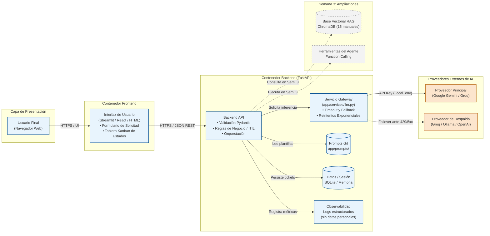
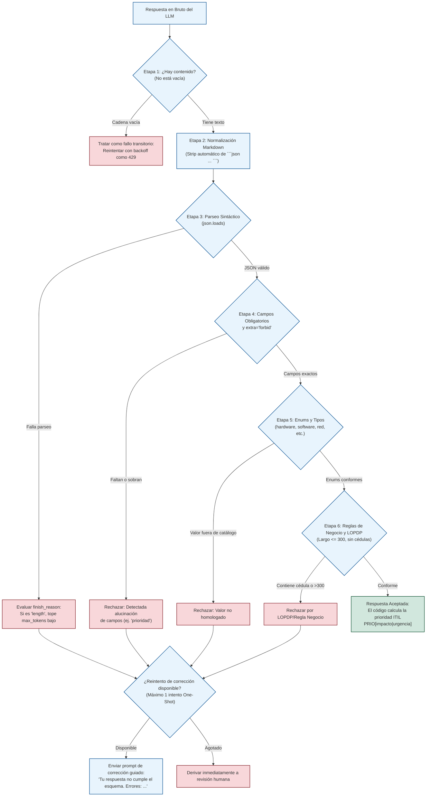
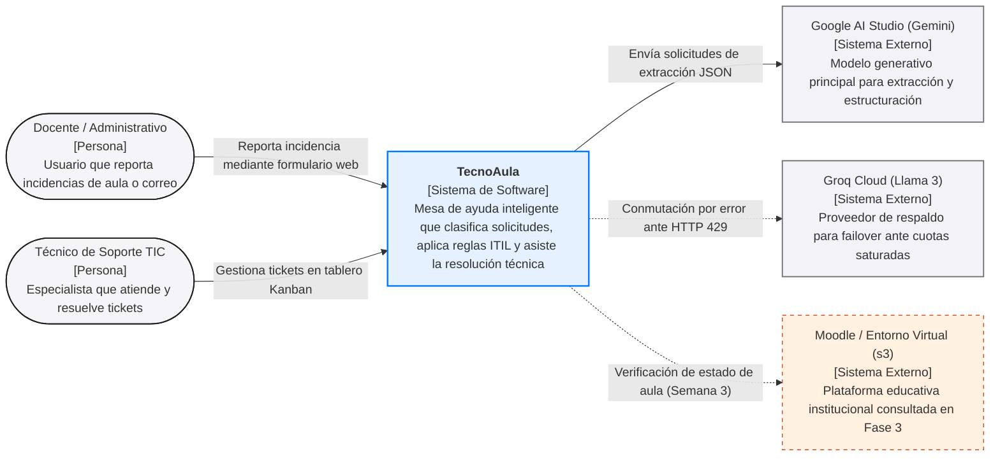
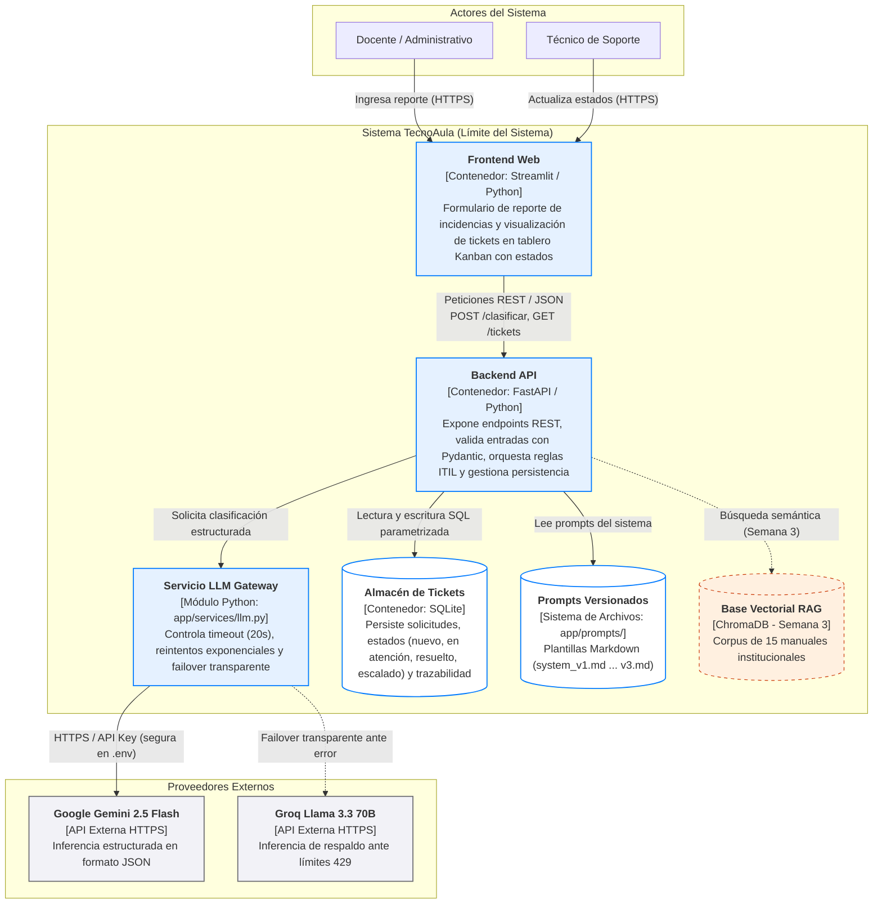

# Compendio Académico · Semana 2: Arquitectura de Aplicaciones Inteligentes, Patrones de Integración y Construcción del MVP
**Seminario de Titulación: Ingeniería de Software con IA Generativa — Desarrollo de Aplicaciones Inteligentes**  
**Módulo 2 · Clase 1: Arquitectura de Aplicaciones Inteligentes (Semana del 19 al 23 de octubre de 2026)**  
**Carrera de Software · Universidad Regional Autónoma de los Andes (UNIANDES)**  
**Docente:** Heyler Fabio Guaza (Ing. Informático · Mg. en Ciberseguridad · OPD · Abogado)  
**Grupo de Desarrollo N.º 03:**  
- Ribera Alajo Luis Fernando  
- Morales Gonzalez Christian Guillermo  
- Iguasnia Escobar Amalia Geoconda  
**Proyecto Asignado:** **TecnoAula — Mesa de Ayuda Inteligente para Instituciones Educativas** (Caso N.º 03 adaptado)  

---

## 1. Introducción y Marco Pedagógico del Módulo 2

El Módulo 2 del seminario marca una transición crítica en el ciclo de vida del desarrollo de software asistido por IA: el paso de la experimentación exploratoria con prompts individuales (Semana 1) hacia la **ingeniería de sistemas de producción** mediante el diseño arquitectónico robusto y la construcción de un Producto Mínimo Viable (MVP).

### 1.1. Metodología Activa: Construcción Colaborativa en Salas
La estructura pedagógica del módulo abandona las tradicionales sesiones magistrales prolongadas y adopta el modelo de **Aprendizaje Activo (*Active Learning*)**, respaldado por investigaciones empíricas en educación en ciencias e ingeniería:

> *"Los estudiantes en cursos tradicionales con clases exclusivamente expositivas tienen 1,5 veces más probabilidades de reprobar que aquellos que participan en esquemas de aprendizaje activo."*  
> — **Freeman et al. (2014), Proceedings of the National Academy of Sciences (PNAS)**

El esquema de trabajo de cada jornada se estructura bajo la regla operativa **«Una hora para pensar, una hora para construir»**:
1. **Exposición concisa (máximo 25 minutos):** Presentación de nuevos patrones arquitectónicos, salvaguardas de seguridad y lineamientos técnicos.
2. **Construcción intensiva en salas de equipo (60 a 75 minutos):** Desarrollo del MVP con objetivos diarios específicos y medibles.
3. **Galería de arquitecturas y retroalimentación entre pares (15 a 20 minutos):** Demostración técnica en vivo ante el docente y compañeros de otros grupos.

### 1.2. Rotación Diaria de Roles de Ingeniería
Para garantizar un trabajo grupal equilibrado, auditable y sin cuellos de botella individuales, cada equipo de tres integrantes rota diariamente entre tres responsabilidades formales:

```
                  ┌────────────────────────────────────────┐
                  │               Tech Lead                │
                  │  (Integra, revisa PRs, guía al equipo) │
                  └───────────────────┬────────────────────┘
                                      │ Rota cada día
                                      ▼
┌─────────────────────────────────────┴─────────────────────────────────────┐
│                                                                           │
│        ┌─────────────────────────┐       ┌─────────────────────────┐      │
│        │         Builder         │       │     QA / Seguridad      │      │
│        │  (Codifica tareas del   │◄─────►│ (Pruebas, mitigación de │      │
│        │  día, commits pequeños) │       │ fallos, cuida secretos) │      │
│        └─────────────────────────┘       └─────────────────────────┘      │
└───────────────────────────────────────────────────────────────────────────┘
```

| Rol | Responsabilidad Nuclear | Criterio de Éxito y Evaluación |
| :--- | :--- | :--- |
| **Tech Lead** | Arquitectura, orquestación técnica, revisión de *Pull Requests*, resolución de bloqueos y sustentación técnica. | **Se evalúa por cómo enseña y alinea al grupo**, no por la cantidad de código que escriba individualmente en aislamiento. |
| **Builder** | Implementación del código de la tarea del día (endpoints, modelos Pydantic, cliente LLM, interfaz). | Commits pequeños, frecuentes y modulares (tiempo de lectura menor a 5 minutos, bajo el estándar *Conventional Commits*). |
| **QA / Seguridad** | Pruebas de integración con dobles (*mocks*), verificación de credenciales (`.env`), manejo de errores 429 y compilación de bitácoras de evidencia. | Garantizar que el repositorio pase la suite de pruebas sin llamadas a APIs de pago y sin secretos expuestos en el historial de Git. |

---

## 2. Responsabilidad Jurídica y Principios de Diseño: El Caso *Air Canada*

La incorporación de modelos generativos en sistemas de producción no exime a una institución u organización de su responsabilidad legal, civil o contractual. La ingeniería de software moderna debe incorporar salvaguardas arquitectónicas para mitigar los riesgos derivados de la naturaleza estocástica del LLM.

### 2.1. El Precedente Judicial: *Moffatt v. Air Canada* (2024 BCCRT 149)
En noviembre de 2022, el pasajero canadiense Jake Moffatt utilizó el chatbot oficial de asistencia al cliente en el portal web de Air Canada tras el fallecimiento de su abuela. 
- **El hecho:** El chatbot aseguró explícitamente al usuario que podía adquirir su boleto de avión a tarifa regular y, dentro de los 90 días posteriores a la emisión, solicitar el reembolso retroactivo por tarifa de duelo (*bereavement policy*).
- **El conflicto:** Al solicitar el reembolso, la aerolínea rechazó el pago, señalando que su política interna real prohibía reembolsos retroactivos y argumentó en sede judicial que **«el chatbot era una entidad legal separada, responsable de sus propias declaraciones»**, por lo que la aerolínea no debía asumir responsabilidad por la información errónea proporcionada por la IA.
- **La sentencia:** En febrero de 2024, el Tribunal de Resolución Civil de Columbia Británica (*Civil Resolution Tribunal*) falló categóricamente en contra de la aerolínea, condenándola a pagar la indemnización solicitada (CAD 812,02):

> *«Debería ser obvio para Air Canada que es legalmente responsable de toda la información difundida en su sitio web, independientemente de si proviene de una página estática o de un chatbot interactivo impulsado por IA.»*  
> — **Moffatt v. Air Canada, 2024 BCCRT 149, párr. 27**

### 2.2. Consecuencia Fundamental y las Tres Defensas de Diseño
El principio rector derivado de este precedente para la ingeniería de software es tajante:  
$$\text{«Lo que dice su modelo, lo dice su organización.»}$$

Para evitar responsabilidades legales, daños institucionales o alucinaciones perjudiciales, el sistema debe implementar **tres defensas estructurales de diseño**:

```
                       ╔═══════════════════════════════════╗
                       ║   TRES DEFENSAS DE DISEÑO DE IA   ║
                       ╚═══════════════════════════════════╝
                                         │
         ┌───────────────────────────────┼───────────────────────────────┐
         ▼                               ▼                               ▼
┌──────────────────┐           ┌──────────────────┐           ┌──────────────────┐
│  Defensa 1:      │           │  Defensa 2:      │           │  Defensa 3:      │
│  Alcance         │           │  Respuestas con  │           │  Derivación      │
│  Acotado         │           │  Fuente (RAG)    │           │  Humana          │
├──────────────────┤           ├──────────────────┤           ├──────────────────┤
│ El sistema solo  │           │ Cada afirmación  │           │ Si no hay fuente │
│ atiende su tema  │           │ técnica debe     │           │ o existe riesgo  │
│ específico; lo   │           │ citar manuales   │           │ normativo/legal, │
│ ajeno lo rechaza │           │ y procedimientos │           │ el sistema no    │
│ amablemente.     │           │ institucionales. │           │ adivina: deriva. │
└──────────────────┘           └──────────────────┘           └──────────────────┘
```

1. **Alcance Estrictamente Acotado (*Scope Guarding*):** El *system prompt* y los validadores de entrada delimitan taxativamente el dominio del sistema. Consultas fuera del ámbito de soporte técnico institucional son rechazadas cordialmente con mensajes estándar.
2. **Respuestas Apoyadas en Fuentes Oficiales (*Grounding*):** Ningún procedimiento técnico se responde desde la memoria paramétrica del modelo. La respuesta debe extraerse y citar textualmente los documentos de soporte (base de conocimiento RAG de 15 manuales en la Semana 3).
3. **Derivación a un Humano (*Human-in-the-Loop*):** Cuando el modelo no encuentra fuentes suficientes, o cuando el incidente requiere acceso físico/administrativo de alto impacto, el sistema se abstiene de improvisar y deriva el caso a un técnico humano mediante la apertura de un ticket.

---

## 3. La Idea Fuerza Central: «El Modelo Propone, el Código Dispone»

En una aplicación inteligente de nivel empresarial o institucional, el Modelo de Lenguaje de Gran Escala (LLM) **no es el cerebro omnipotente del sistema**, sino un **componente estocástico no confiable** que reside detrás de la frontera del software.

```
┌─────────────────────────────────────────────────────────────────────────────┐
│                      «EL MODELO PROPONE, EL CÓDIGO DISPONE»                 │
├─────────────────────────────────────────────────────────────────────────────┤
│                                                                             │
│   EL MODELO (Componente Externo):                                           │
│   • Puede fallar (errores de red, HTTP 429, caídas del proveedor).          │
│   • Tarda tiempo en responder (latencia estocástica de inferencia).         │
│   • Cuesta dinero o agota cuotas limitadas por minuto/día.                  │
│   • Tiende a alucinar si se le exige rigor algorítmico o matemático.        │
│                                                                             │
│   EL CÓDIGO (Software Determinista que lo Encamisa):                        │
│   • Valida y sanitiza las entradas del usuario antes de llamar al modelo.   │
│   • Limita el gasto de tokens, aplica tiempos máximos de espera y cuotas.   │
│   • Impone esquemas estrictos de salida (Pydantic / JSON Schema).           │
│   • Aplica las reglas del negocio y toma las decisiones críticas.           │
│                                                                             │
└─────────────────────────────────────────────────────────────────────────────┘
```

---

## 4. Arquitectura de Referencia: Siete Piezas Alrededor del Modelo

La arquitectura estándar para el MVP de una aplicación basada en modelos generativos se compone de **siete piezas fundamentales**, orquestadas de forma que la interfaz de usuario nunca interactúe directamente con el proveedor del modelo:



### 4.1. Descripción Detallada de las 7 Piezas

| # | Pieza Arquitectónica | Responsabilidad Técnica en el MVP | Implementación Concreta en TecnoAula |
| :-: | :--- | :--- | :--- |
| **1** | **Usuario** | Emite solicitudes de asistencia técnica o reportes de fallos en infraestructura educativa. | Docentes, administrativos o técnicos de aula de la institución. |
| **2** | **Frontend** | Captura la interacción, gestiona estados de carga/espera (*spinners*), deshabilita botones durante llamadas y renderiza el tablero de control. | Interfaz web en **Streamlit** (o HTML5 reactivo con Vanilla CSS), conectada exclusivamente al backend. **Nunca posee claves de API**. |
| **3** | **Backend** | Valida sintáctica y semánticamente la entrada (esquemas Pydantic), aplica reglas ITIL y calcula prioridades. | **FastAPI** (`app/main.py`, `app/schemas.py`, `app/tools/priorizar.py`). |
| **4** | **Gateway LLM** | Encapsula y aísla la comunicación con el modelo generativo. Controla tiempos límite, reintentos y respaldo. | Módulo `app/services/llm.py` que expone una interfaz unificada independiente del SDK del proveedor. |
| **5** | **Modelo (Externo)** | Procesa el texto de la solicitud y genera la salida estructurada solicitada en el prompt. | Modelos de alta velocidad y costo cero para desarrollo: **Google Gemini 2.5 Flash** (principal) y **Groq / Llama 3** (respaldo). |
| **6** | **Prompts Versionados** | Centraliza las instrucciones de comportamiento, delimitación de rol y salvaguardas en archivos auditables. | Directorio `app/prompts/` conteniendo `system_v1.md`, `system_v2.md` y `system_v3.md` bajo control de versiones Git. |
| **7** | **Datos y Memoria** | Persiste el estado de los tickets, las asignaciones técnicas y las transiciones del ciclo de vida. | Base de datos relacional ligera **SQLite** (`data/tickets.db`) con transacciones parametrizadas. |

*Piezas que se integran en la Semana 3:*  
- **Base Vectorial (RAG):** ChromaDB alojando los *embeddings* de los 15 manuales institucionales para citas contextuales.  
- **Herramientas del Agente (*Tools*):** Funciones deterministas (`crear_ticket`, `buscar_solucion`, `escalar`) invocables por el modelo.  
- **Observabilidad:** Registros estructurados en formato JSON (milisegundos de latencia, tokens de entrada/salida y tasa de error), garantizando la no persistencia de datos personales o credenciales (en cumplimiento de la LOPDP ecuatoriana).

---

## 5. El Servicio Gateway (`app/services/llm.py`): Aislamiento y Resiliencia

El Gateway de IA es el componente crítico de infraestructura que protege a la aplicación contra la volatilidad y las fallas de los proveedores externos.

### 5.1. El Principio de Abstracción del Proveedor
Si un equipo acopla sus endpoints llamando directamente a `import google.generativeai` o `import openai` dentro de las funciones de ruta de FastAPI:
- Si el proveedor cambia su SDK o depreca una API (como la eliminación de la *Assistants API* por parte de OpenAI en agosto de 2026), todo el backend se rompe.
- Si el proveedor gratuito agota su cuota de peticiones por minuto (HTTP 429), la aplicación colapsa durante la demostración en vivo.

**Regla de diseño:** El backend solo conoce a `llm.py`. Cambiar de proveedor o de modelo se realiza alterando una única variable en el archivo de configuración `.env`, sin modificar ni una sola línea de código en los controladores.

### 5.2. Mitigación de Concurrencia y el Error HTTP 429: Las Cuatro Estrategias
Cuando múltiples usuarios o componentes solicitan inferencia simultáneamente, se produce una «ola de solicitudes» que colisiona contra las cuotas por ventana de tiempo fijadas por el proveedor (ej. 5 o 15 peticiones por minuto en niveles de desarrollo).

El servicio de integración (`llm.py`) debe implementar una estrategia matemáticamente defendible:

| Estrategia | Mecánica de Ejecución | Comportamiento Técnico en el Sistema | Veredicto Arquitectónico |
| :--- | :--- | :--- | :--- |
| **1. Sin Protección (*Naive*)** | Ninguna. La excepción HTTP 429 viaja intacta al usuario. | El cliente web recibe errores HTTP 500 o fallos de red intempestivos. | **Inaceptable.** El sistema carece de robustez básica. |
| **2. Bucle Inmediato (*Spinning*)** | Reintenta de inmediato en un bucle cerrado (ej. cada 100 ms). | Agota agresivamente las cuotas restantes en fracciones de segundo y bloquea el servicio. | **Peligroso.** Equivale a un ataque de denegación de servicio auto-infligido. |
| **3. Exponencial Determinista** | Reintenta en intervalos fijos $t = 2^{\text{intento}-1}$ (1s, 2s, 4s, 8s). | **Fenómeno de Resonancia (*Thundering Herd*):** Todas las solicitudes bloqueadas en el mismo segundo se sincronizan y vuelven a chocar juntas en el siguiente ciclo. | **Deficiente.** Produce oleadas de congestión periódica. |
| **4. Exponencial con Azar (*Full Jitter*) y `Retry-After`** | Dispersa aleatoriamente el tiempo: $t = \text{base} \times 2^{\text{intento}-1} \pm \text{azar}$, respetando la cabecera `Retry-After`. | Suaviza y distribuye el tráfico en el tiempo. Si se agotan los reintentos, conmuta al respaldo (*failover*). | **Estándar de Producción.** Evita caídas y garantiza el 100 % de respuestas en la demo. |

#### Formulación de *Exponential Backoff with Full Jitter*:
$$t_{\text{espera}} = \text{random\_between}\left(0, \, \min\left(t_{\text{máx}}, \, t_{\text{base}} \times 2^{\text{intento}}\right)\right)$$
$$\text{Espera Efectiva} = \max\left(\text{Cabecera\_Retry\_After}, \, t_{\text{espera}}\right) + \text{jitter}$$

Si tras 3 intentos el proveedor principal no responde, el Gateway conmuta en caliente al **proveedor de respaldo** (Groq / Llama 3.3).

---

### 5.3. El Pipeline de Validación de Respuestas en Seis Etapas (*Defense-in-Depth*)
El modelo generativo es probabilístico. Incluso bajo decodificación restringida (*constrained decoding* con `json_schema`), la respuesta en bruto (*raw response*) debe atravesar seis filtros de auditoría antes de ser admitida por el backend:



1. **Etapa 1 (Verificación de Contenido):** Si la respuesta viene vacía `""` (por micro-cortes de red o censura silenciosa), se trata como error de red y se reintenta con backoff.
2. **Etapa 2 (Normalización Markdown):** Si el LLM devuelve el objeto delimitado por bloques de código ` ```json ... ``` `, una expresión regular extrae el interior limpiamente sin marcar error.
3. **Etapa 3 (Parseo Sintáctico y Detección de Truncamiento):** Si el JSON se encuentra truncado (llaves abiertas), se consulta `finish_reason`. Si es `"length"`, el backend sabe que el presupuesto `max_tokens` quedó corto y debe ajustarse.
4. **Etapa 4 (Cardinalidad Estricta `extra="forbid"`):** Se prohíbe la presencia de campos no declarados. Si el modelo intenta inventar `"prioridad": "P1"`, se rechaza categóricamente, forzando que la prioridad la calcule el código determinista.
5. **Etapa 5 (Validación Semántica de Enums):** Verifica que `categoria`, `impacto` y `urgencia` coincidan exactamente con las opciones del catálogo institucional.
6. **Etapa 6 (Reglas de Negocio y Protección LOPDP):** Verifica que el `resumen` tenga $\le 300$ caracteres y ejecuta expresiones regulares (`\b\d{10}\b`) para alertar sobre la presencia indebida de cédulas de identidad ecuatorianas o credenciales personales.

#### Bucle de Corrección Estructurada (*One-Shot Repair Loop*):
Si la respuesta falla en las etapas 3 a 6, el backend construye un mensaje de corrección guiado:  
*«Tu respuesta no cumple el esquema. Errores: [lista exacta de fallos Pydantic]. Devuelve SOLO el JSON corregido.»*  
**Regla de ingeniería:** Se permite **un solo reintento de corrección**. Si vuelve a fallar, el caso se escala a un técnico humano para prevenir bucles infinitos de tokens y demoras al usuario.

---

### 5.4. Anatomía de la Llamada HTTP y Economía de Tokens
El servicio Gateway estructura las llamadas hacia proveedores compatibles con el estándar de OpenAI (`POST .../chat/completions`):

```http
POST /v1beta/openai/chat/completions HTTP/1.1
Host: generativelanguage.googleapis.com
Authorization: Bearer $GEMINI_API_KEY
Content-Type: application/json

{
  "model": "gemini-2.5-flash",
  "messages": [
    {"role": "system", "content": "Instrucciones de rol y abstención (system_v3.md)..."},
    {"role": "user", "content": "Solicitud técnica enviada por el usuario..."}
  ],
  "max_tokens": 2048,
  "temperature": 0.2,
  "reasoning_effort": "low",
  "response_format": {
    "type": "json_schema",
    "json_schema": {
      "name": "ClasificacionSoporte",
      "strict": true,
      "schema": { "..." : "..." }
    }
  }
}
```

* **Asimetría de Costos:** Los tokens de salida son entre **$4\times$ y $5\times$ más costosos** que los de entrada (ej. Gemini Flash: USD 0,75 entrada vs. USD 3,75 salida por millón).
* **El costo del razonamiento (*Thinking Tokens*):** Cuando se habilita `reasoning_effort` (`medium` o `high`), los tokens generados por el modelo para razonar internamente **se facturan íntegramente como tokens de salida**. Para tareas de clasificación determinista como el triaje de TecnoAula, el razonamiento debe fijarse en `low` o desactivarse para proteger el presupuesto y minimizar la latencia.

---

### 5.5. Arquitectura del Gateway en Código (`app/services/llm.py`)
```python
# app/services/llm.py (Implementación conceptual robusta)
import os
import time
import random
import logging
from typing import Dict, Any, Type
from pydantic import BaseModel, ValidationError

logger = logging.getLogger("tecnoaula.llm_gateway")

class LLMGateway:
    def __init__(self):
        self.primary_provider = os.environ.get("LLM_PROVIDER", "gemini")
        self.primary_model = os.environ.get("LLM_MODEL", "gemini-2.5-flash")
        self.fallback_provider = os.environ.get("LLM_FALLBACK_PROVIDER", "groq")
        self.fallback_model = os.environ.get("LLM_FALLBACK_MODEL", "llama-3.3-70b-versatile")
        self.timeout = float(os.environ.get("LLM_TIMEOUT_SECONDS", "20.0"))

    def invocar_con_resiliencia(self, system_prompt: str, user_prompt: str, schema_cls: Type[BaseModel]) -> BaseModel:
        """
        Ejecuta la inferencia aplicando Backoff con Full Jitter, conmutación
        automática ante 429 y bucle de corrección guiado de un solo intento.
        """
        intentos = 3
        base_espera = 1.0

        for intento in range(1, intentos + 1):
            try:
                raw_json = self._llamar_api(self.primary_provider, self.primary_model, system_prompt, user_prompt, schema_cls)
                return self._validar_y_reparar(raw_json, schema_cls, system_prompt, user_prompt)
            except Exception as e:
                err_msg = str(e).lower()
                if "429" in err_msg or "timeout" in err_msg or "50" in err_msg:
                    if intento < intentos:
                        jitter = random.uniform(0.1, 0.5)
                        espera = (base_espera * (2 ** (intento - 1))) + jitter
                        logger.warning(f"HTTP 429/Timeout con {self.primary_provider}. Reintentando en {espera:.2f}s...")
                        time.sleep(espera)
                    else:
                        logger.error(f"Agotados reintentos con {self.primary_provider}. Activando Failover...")
                else:
                    raise e

        # Failover al proveedor de respaldo
        try:
            logger.info(f"Conmutando tráfico al proveedor de respaldo: {self.fallback_provider}")
            raw_fallback = self._llamar_api(self.fallback_provider, self.fallback_model, system_prompt, user_prompt, schema_cls)
            return self._validar_y_reparar(raw_fallback, schema_cls, system_prompt, user_prompt)
        except Exception as e_fb:
            logger.critical(f"Proveedor de respaldo también falló: {str(e_fb)}")
            raise RuntimeError("Servicio de IA saturado. Su solicitud ha sido asignada a revisión técnica manual.")

    def _validar_y_reparar(self, raw_data: Dict[str, Any], schema_cls: Type[BaseModel], sys_p: str, usr_p: str) -> BaseModel:
        try:
            return schema_cls.model_validate(raw_data)
        except ValidationError as val_err:
            logger.warning(f"Respuesta no conforme al esquema. Iniciando reparación One-Shot: {val_err}")
            repair_prompt = f"Tu salida anterior tuvo errores de validación:\n{val_err}\nCorrige y devuelve SOLO el JSON válido."
            repaired_raw = self._llamar_api(self.primary_provider, self.primary_model, sys_p, repair_prompt, schema_cls)
            return schema_cls.model_validate(repaired_raw)  # Si vuelve a fallar, escala la excepción

    def _llamar_api(self, prov: str, model: str, sys_p: str, usr_p: str, schema_cls: Type[BaseModel]) -> Dict[str, Any]:
        # Ejecuta la llamada al SDK del proveedor configurando structured output
        pass
```

---

## 6. Desarrollo Backend de Producción: Contratos, Concurrencia, Memoria y Ciberseguridad

Para que la arquitectura de referencia y el Gateway funcionen en producción, el backend implementa seis principios fundamentales de ingeniería de software con FastAPI:

### 6.1. La Frontera de Confianza (*Trust Boundaries*)
- **Navegador (No Confiable):** Nunca posee claves, no ejecuta lógica de decisión y no custodia el historial. El texto se renderiza escapado para mitigar XSS (OWASP LLM05).
- **Backend (Confiable):** FastAPI + Pydantic. Custodia `GEMINI_API_KEY`, valida entradas, ejecuta reglas matriciales ITIL y persiste el historial verídico en SQLite.
- **Proveedor (Externo):** Servicio externo cuyas respuestas se tratan como datos no confiables y se auditan antes de admitir.

### 6.2. Contratos de API con OpenAPI 3.1 y `response_model`
- `response_model=ClasificacionTicketOut`: Filtra la salida para evitar fugas de datos personales (cédula, nombres - LLM02), del system prompt (LLM07) o de infraestructura interna.
- Código de estado semántico: `status_code=201 Created` al guardar un nuevo ticket con identificador único.
- Versionamiento explícito en la ruta (`/v1/clasificar`).

### 6.3. Errores como Datos: Estándar RFC 9457 (*Problem Details for HTTP APIs*)
- Respuestas de error estructuradas bajo `application/problem+json`: `type`, `title`, `status`, `detail`, `instance`.
- Códigos: `422` para entradas inválidas, `429` con `Retry-After: 6` para límites de sesión, `503` con `Retry-After: 30` para caídas de proveedores, y `500` con `request_id` anónimo (traceback reservado para `logs/`).
- **Decisión de Negocio (`200 OK`):** Si la validación falla tras la corrección guiada, se responde `200 OK` con `requiere_revision_humana: true`. No es un fallo HTTP, sino una decisión del servicio.

### 6.4. Concurrencia en FastAPI: El Pool de AnyIO vs el Bloqueo del Event Loop
- **Peligro fatal:** `async def` con cliente síncrono bloquea el bucle de eventos único; 30 usuarios tardan 120 s en ser atendidos secuencialmente.
- **Solución del kit:** Declarar endpoints con `def` convencional. FastAPI delega automáticamente a un pool de 40 hilos de AnyIO, atendiendo a 30 usuarios concurrentes en 4 s.
- **Escala asíncrona:** Si se usa `async def` + `AsyncOpenAI`, se debe restringir la concurrencia con `asyncio.Semaphore(10)` para no saturar las cuotas externas.

### 6.5. Memoria de Conversación y Context Caching Implícito
- Gemini cachea prefijos idénticos de $\ge 4.096$ tokens (-50% latencia, -75% costo).
- Orden canónico: 1. System prompt (fijo, ~4.600 tokens) $\to$ 2. Resumen antiguo $\to$ 3. Turnos recientes de SQLite $\to$ 4. Pregunta nueva.
- La marca de tiempo `datetime.now()` nunca debe ubicarse al inicio del system prompt (destruye el prefijo cacheable).
- El frontend solo envía `session_id`; el backend recupera el historial verídico de SQLite (evita falsificación de turnos pasados).

### 6.6. Streaming (SSE) vs Salidas Estructuradas (JSON)
- Texto libre conversacional: Sí se transmite en streaming con Server-Sent Events (`EventSourceResponse`) para reducir el TTFT a < 0,4 s.
- Salidas estructuradas (JSON de triaje): **NUNCA en streaming**. Un JSON incompleto no se puede validar ni parsear. Se entregan completas y auditadas.

### 6.7. Ciberseguridad OWASP LLM 2025 y Algoritmo de Cubeta de Fichas
- **Defensa en 4 capas contra Inyección (LLM01):** Delimitación XML (`<solicitud>`), esquema cerrado (`extra="forbid"`), decisión en código Python y salida escapada (LLM05).
- **Cubeta de Fichas (*Token Bucket* - LLM10):** Limita ráfagas por sesión (10 fichas, recarga 1 cada 6 s). Si un bot automatizado envía 20 peticiones en 2 s, el backend emite su propio HTTP 429 con `Retry-After`, protegiendo la cuota externa.
- **Pruebas con Dobles (*Mocks*):** `pytest` utiliza `app.dependency_overrides` para inyectar dobles simulados (`DobleLLM`), garantizando pruebas en milisegundos sin internet y sin gastar API.

---

## 7. Desarrollo Frontend de Producción: La Máquina de 7 Estados, Streaming por POST y Renderizado Seguro

El frontend es la cara del contrato diseñado en el backend. En aplicaciones impulsadas por modelos generativos, la interfaz no puede limitarse a un formulario clásico; debe gobernar una **máquina de estados finitos resiliente** y neutralizar vulnerabilidades de inyección en el cliente.

### 7.1. La Máquina de los Siete Estados de una Interfaz con IA
Para evitar estados imposibles o pantallas congeladas, la interfaz modela taxativamente siete estados (unión discriminada en TypeScript):
1. **`Inactiva` (*Idle*):** Esperando la entrada del usuario en el formulario.
2. **`Enviando` (*Sending*):** Petición enviada al backend, esperando el primer byte (indicador de carga activo, botones deshabilitados).
3. **`Recibiendo` (*Streaming*):** Leyendo el flujo de tokens en vivo mediante `ReadableStream`.
4. **`Completa` (*Done*):** Respuesta validada recibida; renderizado del resultado y formulario listo.
5. **`Revisión Humana` (HTTP 200 con `requiere_revision_humana=True`):** El modelo presentó dudas o salida no conforme; aviso sereno informando que un técnico revisará el caso (no es un error).
6. **`Reintentar` (HTTP 429 con `Retry-After: N`):** Límite de sesión alcanzado; cuenta regresiva visible, **conservando intacto el texto escrito** por el usuario.
7. **`Caído` (HTTP 503):** Falla general de proveedores; mensaje comprensible sin culpar al usuario («Servicio temporalmente congestionado»).

### 7.2. Contrato Primero: Tipado Extremo a Extremo (`openapi-typescript`)
Los tipos del frontend **se generan automáticamente desde el `/openapi.json` de FastAPI**, nunca se copian a mano:
```bash
npx openapi-typescript http://localhost:8000/openapi.json -o src/api/esquema.ts
```
Si el backend modifica un esquema en Pydantic, el frontend deja de compilar en local antes de llegar al usuario, garantizando cero sobrecosto en ejecución (*zero-bundle overhead*).

### 7.3. Streaming por POST con `ReadableStream` y Botón Detener (*AbortController*)
La API nativa `EventSource` solo soporta peticiones `GET`. Para enviar payloads JSON en el cuerpo (`POST /v1/chat/stream`), el frontend implementa lectura de streams con `fetch` y decodificación de fragmentos:
- **Acumulador de buffer:** La red corta trozos de forma arbitraria; se acumula en un buffer, se divide por `\n\n` y se parsean eventos `token` y `fin`.
- **Botón Detener (*AbortController*):** Al pulsar *Detener*, `ctrl.abort()` cierra inmediatamente la conexión HTTP; el backend detiene el generador en `llm.py` y **el modelo deja de facturar tokens**.

### 7.4. Renderizado Seguro (OWASP LLM05: *Improper Output Handling*)
La salida del modelo generativo es **texto no confiable**: se muestra, **nunca se ejecuta**.
- **Peligro fatal:** `el.innerHTML = texto` o `dangerouslySetInnerHTML`. Permite que ataques de inyección indirecta ejecuten scripts maliciosos (XSS) y roben cookies de sesión.
- **Seguro por defecto:** `<p>{texto}</p>` o `el.textContent = texto`.
- **Markdown sanitizado:** Si se formatea Markdown, el orden es estricto: **primero se convierte a HTML y luego se sanitiza obligatoriamente con DOMPurify**:
  ```javascript
  const htmlLimpio = DOMPurify.sanitize(marked.parse(textoGenerado));
  ```
  Enlaces restringidos exclusivamente a protocolos `http` o `https` con `rel="noopener noreferrer"`.

### 7.5. Gestión de Secretos en el Cliente (OWASP LLM02)
Todo lo que viaja al navegador es público. En Vite, las variables con prefijo `VITE_` se incrustan en el código compilado dentro de `dist/`.
- `VITE_BACKEND_URL=http://localhost:8000` $\to$ Pública, correcto.
- `VITE_GEMINI_KEY=AIza...` $\to$ **PROHIBICIÓN ESTRICTA.** Expone la clave en el JavaScript publicado.
- **Auditoría obligatoria antes de entregar:** Ejecutar `grep -rn "AIza" dist/` debe dar cero resultados.

### 7.6. Accesibilidad Web (WAI-ARIA & WCAG 2.2)
- **Evitar el lector parlanchín:** Un sintetizador de voz no debe anunciar cada token individual. Se utiliza `aria-live="polite"` y `aria-busy="true"` mientras llega el stream; el lector anuncia la respuesta completa una sola vez cuando llega el evento `fin`.
- Errores críticos (429, 503) utilizan `role="alert"` para notificación inmediata.
- Navegación por teclado: `Enter` envía, `Escape` aborta el streaming. Foco retorna al campo de texto al terminar.

---

## 8. Workflows vs. Agentes: La Guía de Arquitectura de Anthropic (2024)

Uno de los errores más comunes en proyectos de IA Generativa es construir agentes autónomos complejos basados en bucles de razonamiento libres (*ReAct*) para problemas que se resuelven con mayor velocidad, bajo costo y total determinismo mediante **flujos de trabajo (*workflows*)**.

### 8.1. La Distinción Nuclear
La investigación seminal de **Anthropic (2024)**, *«Building Effective Agents»*, establece la distinción formal según el locus de control:

```
┌─────────────────────────────────┐           ┌─────────────────────────────────┐
│            WORKFLOW             │           │             AGENTE              │
├─────────────────────────────────┤           ├─────────────────────────────────┤
│ Sistemas donde los LLM y las    │           │ Sistemas donde los LLM dirigen  │
│ herramientas se orquestan       │           │ dinámicamente sus propios pasos │
│ mediante rutas de código        │           │ y el uso de herramientas en un  │
│ predefinidas.                   │           │ bucle de ejecución autónomo.    │
├─────────────────────────────────┤           ├─────────────────────────────────┤
│       «DECIDE SU CÓDIGO»        │           │       «DECIDE EL MODELO»        │
└─────────────────────────────────┘           └─────────────────────────────────┘
```

### 8.2. La Regla de Oro de la Complejidad Arquitectónica
> ***«Empiece con un workflow. Gánese el derecho a un agente.»***  
> — Anthropic (2024)

* **Justificación técnica:** Al evaluar los resultados del benchmark *SWE-bench* (resolución autónoma de problemas reales de repositorios de software), el equipo de Anthropic descubrió que la mayor ganancia de efectividad no provino de darle mayor autonomía al prompt general del agente, sino de **diseñar herramientas deterministas precisas y encadenamientos de código controlados**.
* Un flujo de trabajo ofrece:
  1. **Predecibilidad:** La secuencia de pasos y los estados de error son deterministas y reproducibles.
  2. **Baja latencia:** No hay bucles iterativos innecesarios consultando al modelo una y otra vez.
  3. **Menor costo:** Consumo de tokens estrictamente limitado y presupuestable.
  4. **Facilidad de prueba:** Cada paso del workflow se puede aislar mediante pruebas unitarias con dobles de prueba (*mocks*).

---

## 9. Los Cinco Patrones Canónicos de Workflow

Anthropic documenta cinco patrones de orquestación de llamadas a modelos generativos:

```
                                  ╔═══════════════════════════════╗
                                  ║ LOS CINCO PATRONES DE WORKFLOW║
                                  ╚═══════════════════════════════╝
                                                  │
         ┌──────────────────┬─────────────────────┼─────────────────────┬──────────────────┐
         ▼                  ▼                     ▼                     ▼                  ▼
┌─────────────────┐┌─────────────────┐  ┌─────────────────┐   ┌─────────────────┐┌─────────────────┐
│ 1. Encadenamiento││ 2. Enrutamiento │  │3. Paralelizador │   │ 4. Orquestador y││ 5. Evaluador y  │
│    (Chaining)   ││    (Routing)    │  │ (Parallelization│   │   Trabajadores  ││   Optimizador   │
├─────────────────┤├─────────────────┤  ├─────────────────┤   ├─────────────────┤├─────────────────┤
│ Paso A alimenta ││ Clasifica la    │  │ Subtareas en    │   │ Un LLM divide   ││ Un LLM genera y │
│ a Paso B tras   ││ entrada y envía │  │ paralelo que se │   │ y N trabajadores││ otro critica y  │
│ validación en   ││ al prompt o     │  │ sintetizan al   │   │ resuelven antes ││ refina hasta un │
│ código.         ││ flujo idóneo.   │  │ final.          │   │ de consolidar.  ││ umbral de éxito.│
└─────────────────┘└─────────────────┘  └─────────────────┘   └─────────────────┘└─────────────────┘
```

### 9.1. Detalle Técnico de los Patrones

| Patrón | Mecánica de Ejecución | Cuándo Utilizarlo | Ejemplo en Casos del Seminario |
| :--- | :--- | :--- | :--- |
| **1. Encadenamiento (*Prompt Chaining*)** | Descompone una tarea en pasos secuenciales. La salida del primer paso es validada con esquemas antes de ser enviada como entrada al siguiente paso. | Cuando la tarea involucra etapas lógicas claramente diferenciables (ej. extraer datos y luego redactar). | **Caso 06 (Contratación Pública):** Primero extrae tipo, objeto y monto del pliego; luego genera el resumen estructurado de observaciones. |
| **2. Enrutamiento (*Routing*)** | Una llamada inicial de clasificación evalúa la intención del usuario y bifurca la ejecución hacia un prompt o servicio especializado. | Cuando existen categorías disjuntas de consultas que requieren distintas instrucciones o salvaguardas. | **Caso 05 (Salud / Dengue):** Clasifica si el paciente reporta signos de alarma (flujo urgente) o preguntas de prevención (flujo educativo). |
| **3. Paralelización (*Parallelization*)** | Ejecuta múltiples llamadas al LLM de forma simultánea e independiente (vía `asyncio.gather`), combinando sus respuestas. | Dos modalidades: *Sectioning* (dividir un documento grande) o *Voting* (generar varias opciones para seleccionar la mejor). | **Caso 10 (Revisor de Código):** Analiza tres archivos de un repositorio de manera concurrente para optimizar tiempo. |
| **4. Orquestador y Trabajadores (*Orchestrator-Workers*)** | Un modelo coordinador desglosa un problema dinámico en subtareas, despacha trabajadores especializados y consolida el resultado. | Cuando no es posible predecir de antemano qué subtareas o cuántas etapas requerirá la solicitud del usuario. | **Caso 04 (Turismo):** El orquestador divide el viaje en días según preferencias y despacha tareas por ciudad antes de unir el itinerario. |
| **5. Evaluador y Optimizador (*Evaluator-Optimizer*)** | Un modelo produce una solución borrador y un segundo modelo (o el mismo con distinto prompt) evalúa la calidad y solicita correcciones en bucle. | Tareas donde existen criterios claros de evaluación y los intentos iterativos mejoran visiblemente el resultado final. | **Caso 02 (Reclamos de Consumo):** El generador redacta el reclamo legal y el evaluador valida si cumple todos los artículos de la LODC antes de finalizar. |

---

## 10. Determinismo Estricto: Lo que el Modelo NUNCA Debe Calcular

En la ingeniería de software con IA Generativa, **un LLM jamás debe realizar cálculos matemáticos, cálculos de fechas normativas o decisiones con consecuencias legales, económicas, de salud o de priorización operativa**.

```
┌─────────────────────────────────────────────────────────────────────────────┐
│                          FRONTERA DEL DETERMINISMO                          │
├─────────────────────────────────────────────────────────────────────────────┤
│                                                                             │
│   ❌ LO QUE EL MODELO NUNCA DEBE CALCULAR:                                  │
│   • Caso 07 (Laboral): Décimos, vacaciones y liquidaciones monetarias.       │
│   • Caso 11 (Tributario): Fechas de vencimiento según el noveno dígito.     │
│   • Caso 05 (Salud): Diagnóstico de gravedad o recetario farmacológico.     │
│   • Caso 06 (Contratación): Umbrales normativos según el PGE vigente.       │
│   • Caso 03 (TecnoAula): Prioridad final del ticket y tiempos SLA.          │
│                                                                             │
│   ✅ LA REGLA ARQUITECTÓNICA DE ORO:                                        │
│   «Si tiene efectos legales, económicos, de criticidad o de salud:          │
│    LO CALCULA EL CÓDIGO MEDIANTE FUNCIONES DETERMINISTAS Y TABLAS.          │
│    EL MODELO ÚNICAMENTE EXPLICA, EXTRAE O TRADUCE EL RESULTADO.»            │
│                                                                             │
└─────────────────────────────────────────────────────────────────────────────┘
```

### 10.1. Aplicación Determinista en TecnoAula (Caso 03)
En TecnoAula, el modelo de IA clasifica la solicitud del docente y **propone** únicamente el nivel de `impacto` y `urgencia`. La **prioridad del ticket** y los tiempos máximos de respuesta (SLA) son calculados de forma 100 % determinista por una función en Python (`app/tools/priorizar.py`) leyendo las reglas matriciales ITIL desde `config/matriz_prioridad.json`:

$$\text{Prioridad} = \text{Matriz\_ITIL}[\text{Impacto}][\text{Urgencia}]$$

```
                   URGENCIA
           │  Alta    │  Media   │   Baja   │
     ──────┼──────────┼──────────┼──────────┤
     Alto  │  CRÍTICA │   ALTA   │  MEDIA   │
 I   ──────┼──────────┼──────────┼──────────┤
 M   Medio │   ALTA   │  MEDIA   │   BAJA   │
 P   ──────┼──────────┼──────────┼──────────┤
     Bajo  │  MEDIA   │   BAJA   │   BAJA   │
```

Si el proyector de un aula falla durante una clase en vivo, el LLM clasifica `urgencia: "alta"` e `impacto: "alto"`. La función en Python determina de inmediato que la prioridad es **Alta** y asigna un SLA de resolución menor a 15 minutos, sin permitir que el modelo "adivine" o altere la severidad.

---

## 11. Requisitos No Funcionales (RNF) y Presupuestos de Inferencia

El reporte anual **Stanford HAI AI Index Report (2025)** documenta un fenómeno revolucionario en la economía del software:  
> Entre noviembre de 2022 y octubre de 2024, el costo de inferencia por millón de tokens en modelos con capacidades equivalentes a GPT-3.5 se redujo en **más de 280 veces** (pasando de USD 20,00 a USD 0,07).

Sin embargo, **«precio bajo no significa factura baja»**. Si una aplicación entra en bucles recursivos descontrolados, carece de límites de tamaño de entrada o emite respuestas verbosas innecesarias, los costos y tiempos de respuesta colapsan la viabilidad del proyecto.

### 11.1. Presupuestos de Ingenería del MVP (Caso TecnoAula)

| Requisito No Funcional | Métrica / Presupuesto | Mecanismo de Control en el Software |
| :--- | :--- | :--- |
| **Latencia (*Time to First Token*)** | $\le 3,0$ segundos hasta la respuesta inicial. | Uso de modelos optimizados para inferencia flash (*Gemini 2.5 Flash* o *Llama 3.3 70B* en Groq) y streaming HTTP. |
| **Máximo de Tokens de Salida** | $\le 600$ tokens por clasificación. | Configuración estricta en el payload del Gateway (`max_output_tokens=600`). |
| **Temperatura del Modelo** | $0,2$ (determinismo y estabilidad estructural). | Parámetro `temperature=0.2` en `app/services/llm.py` para evitar dispersión en clasificaciones JSON. |
| **Máximo de Entrada de Texto** | $\le 2000$ caracteres por solicitud. | Validación con Pydantic (`Field(max_length=2000)`) en el endpoint de FastAPI antes de invocar la red. |
| **Límite de Tasa (*Rate Limiting*)**| $\le 10$ solicitudes por minuto por IP. | Middleware de control de tráfico en FastAPI para evitar abuso de la cuota del proveedor gratuito. |
| **Disponibilidad y Resiliencia** | Tolerancia a HTTP 429 y caídas de API. | Mecanismo de conmutación automática (*failover*) al proveedor secundario en menos de 2 segundos. |

---

## 12. Principios de *12-Factor Agents* (HumanLayer)

Inspirado en la metodología de *The Twelve-Factor App* de Heroku para aplicaciones cloud nativas, la iniciativa **12-Factor Agents** (HumanLayer, 2024) formaliza las mejores prácticas para construir sistemas basados en LLM que alcancen nivel de producción.

En la Semana 2 se implementan rigurosamente **cuatro de los doce factores**:

```
 ┌─────────────────────────────────────────────────────────────────────────────┐
 │                      12-FACTOR AGENTS (HumanLayer)                          │
 ├─────────────────────────────────────────────────────────────────────────────┤
 │                                                                             │
 │   Factor 2: Controle sus Prompts                                            │
 │   Los prompts son código fuente. Viven en archivos versionados en Git       │
 │   (ej. app/prompts/system_v1.md), nunca ocultos como strings sueltos        │
 │   dentro de los controladores o el código de la aplicación.                 │
 │                                                                             │
 │   Factor 3: Controle su Ventana de Contexto                                 │
 │   Decida explícitamente qué entra y qué no entra en cada llamada al         │
 │   modelo. Minimice los tokens inyectados para reducir costos y evitar       │
 │   el fenómeno de "pérdida en el medio" (lost-in-the-middle).                │
 │                                                                             │
 │   Factor 4: Las Herramientas son Salidas Estructuradas                      │
 │   Una herramienta invocable no es texto libre: es un objeto JSON estricto   │
 │   que el código del backend valida con Pydantic antes de ejecutar.          │
 │                                                                             │
 │   Factor 8: Controle el Flujo de Ejecución                                  │
 │   El orden y la bifurcación de los pasos los decide su software mediante    │
 │   estructuras de control convencionales (if/else, autómatas finitos), no    │
 │   un modelo generativo que decida arbitrariamente qué hacer a continuación. │
 │                                                                             │
 └─────────────────────────────────────────────────────────────────────────────┘
```

> *«Una tasa de éxito del 80 % puede sonar impresionante en una demo académica, pero es completamente inaceptable para cualquier función de software de cara al usuario final.»*  
> — HumanLayer (2024)

---

## 13. Instrucción Entre Pares (*Peer Instruction*): Análisis de Casos Críticos

Durante la sesión se implementó la metodología de **Instrucción entre Pares** desarrollada por **Eric Mazur (Harvard University)**: votación individual en silencio, debate de dos minutos en equipo para defender argumentos técnicos y segunda votación para medir convergencia conceptual.

### Pregunta 1: Detección de Signos de Alarma en Asistentes Críticos
* **Escenario:** En una aplicación médica o de soporte crítico, ¿dónde se decide si el caso presenta un síntoma de alarma grave?
  - *Opción A:* En el system prompt con una lista de síntomas.
  - *Opción B:* En un agente autónomo que decide libremente qué hacer.
  - *Opción C (Correcta):* **En reglas de código deterministas tomadas de la guía oficial; el modelo únicamente explica.**
  - *Opción D:* En el frontend para que responda más rápido.
* **Justificación de ingeniería:** Las decisiones con consecuencias de salud o seguridad física no pueden someterse a la probabilidad estocástica de un LLM. El código ejecuta la coincidencia de reglas y dispara el protocolo de emergencia de forma determinista.

### Pregunta 2: Exposición de Secretos y Vulnerabilidad OWASP LLM07
* **Escenario:** Un grupo incluye la clave secreta de su API dentro del system prompt "para que el modelo la use cuando necesite llamar a un servicio". ¿Qué ocurre?
  - *Opción A:* Nada, si el repositorio es privado.
  - *Opción B (Correcta):* **El system prompt puede filtrarse en una respuesta (*System Prompt Leakage*), y la clave con él.**
  - *Opción C:* Es más seguro, porque el usuario final no ve el system prompt.
  - *Opción D:* Solo sube el costo por tener más tokens.
* **Justificación de ciberseguridad:** Según el estándar **OWASP Top 10 for LLM Applications (2025)**, la vulnerabilidad **LLM07 (System Prompt Leakage)** permite que ataques de inyección indirecta induzcan al modelo a repetir sus instrucciones iniciales. Todo secreto incluido en el prompt queda irrevocablemente expuesto. Las credenciales deben residir exclusivamente en variables de entorno leídas por el backend.

### Pregunta 3: Mitigación de Saturación de Cuotas en Demostraciones
* **Escenario:** El viernes, en plena sustentación ante el docente, el proveedor de IA responde con el código de error HTTP 429 (Límite de solicitudes excedido). ¿Qué diseño sale airoso?
  - *Opción A:* Reintentar de inmediato, en bucle infinito cerrado.
  - *Opción B:* Devolver un error 500 y pedir disculpas.
  - *Opción C (Correcta):* **Reintentar con espera creciente (*exponential backoff*); si persiste, conmutar al proveedor de respaldo y avisar limpiamente al usuario.**
  - *Opción D:* Modificar el prompt sobre la marcha para gastar menos tokens.
* **Justificación arquitectónica:** La combinación del patrón *Retry with Backoff* y un *Fallback Provider* dentro de `llm.py` asegura alta disponibilidad del servicio sin interrumpir la experiencia de usuario ni alterar el código.

---

## 14. Modelado Visual con el Modelo C4 (Simon Brown)

Para comunicar con precisión la estructura del sistema sin recurrir a diagramas informales ambiguos de "cajas y flechas", el proyecto utiliza el **Modelo C4 de Simon Brown**:

```
                         ╔═══════════════════════════════╗
                         ║       EL MODELO C4            ║
                         ╚═══════════════════════════════╝
                                         │
         ┌───────────────────────────────┼───────────────────────────────┐
         ▼                               ▼                               ▼
┌──────────────────┐           ┌──────────────────┐           ┌──────────────────┐
│  NIVEL 1:        │           │  NIVEL 2:        │           │  NIVEL 3 y 4:    │
│  Contexto        │           │  Contenedores    │           │  Componentes y   │
│  (El País)       │           │  (La Ciudad)     │           │  Código          │
├──────────────────┤           ├──────────────────┤           ├──────────────────┤
│ El sistema como  │           │ Desglose en      │           │ Clases internas  │
│ una caja negra,  │           │ aplicaciones web,│           │ y funciones. No  │
│ sus usuarios y   │           │ APIs, bases de   │           │ se dibujan para  │
│ sistemas externos│           │ datos y gateway. │           │ este entregable. │
└──────────────────┘           └──────────────────┘           └──────────────────┘
```

> **Aclaración clave:** En el modelo C4, un **contenedor** no es un contenedor Docker, sino una unidad ejecutable de software independiente (una aplicación frontend, una API backend, una base de datos o un almacén de archivos).

### 14.1. Diagrama C4 Nivel 1: Contexto de TecnoAula
Visualiza la interacción de alto nivel entre los actores educativos, TecnoAula y los servicios de IA de soporte:



### 14.2. Diagrama C4 Nivel 2: Contenedores del MVP de TecnoAula
Muestra los límites de proceso, protocolos de comunicación y tecnologías empleadas:



---

## 15. Registro de Decisiones de Arquitectura (ADR)

Un **Registro de Decisión de Arquitectura (*Architecture Decision Record - ADR*)** es un documento breve y versionado que captura una decisión técnica significativa, el contexto en que se tomó y sus consecuencias.

### 15.1. Formato Canónico de Michael Nygard (2011)
Los ADRs no se borran ni se sobreescriben. Si una decisión cambia a lo largo del tiempo, se formula un nuevo ADR y el anterior se marca como `Reemplazado` con un enlace al nuevo registro:

1. **Título:** Frase corta numerada (ej. `ADR-001: Selección de proveedor y modelo generativo principal`).
2. **Estado:** `Propuesto`, `Aceptado`, `Reemplazado` o `Rechazado`.
3. **Fecha y Responsables:** Día de consenso y miembros que participaron en el análisis.
4. **Contexto:** Fuerzas técnicas, legales, económicas y restricciones que motivan la decisión.
5. **Opciones Consideradas:** Mínimo dos alternativas reales, detallando ventajas y desventajas.
6. **Decisión:** Enunciado afirmativo en voz activa explicando el porqué de la elección: *«Usaremos X porque Y»*.
7. **Consecuencias:** Lo que se gana (positivas) y los compromisos asumidos o riesgos asumidos (negativas).

### 15.2. Los ADRs Obligatorios de la Semana 2 para TecnoAula

```
┌─────────────────────────────────────────────────────────────────────────────┐
│                 REGISTRO DE DECISIONES DE ARQUITECTURA (ADR)                │
├─────────────────────────────────────────────────────────────────────────────┤
│                                                                             │
│   • ADR-001: Proveedor y Modelo Generativo                                  │
│     Decisión: Google Gemini 2.5 Flash como principal y Groq como respaldo.   │
│     Razón: Nivel gratuito generoso, soporte nativo de JSON Schema y baja    │
│     latencia. Respaldo garantiza la demo si se agota la cuota.              │
│                                                                             │
│   • ADR-002: Patrón de Integración de IA (Workflow Determinista)            │
│     Decisión: Llamada única con salida estructurada Pydantic (Workflow).    │
│     Razón: En la Semana 2 no se requiere bucle de agente; la tarea es de    │
│     clasificación y triaje con predecibilidad 100 % verificable.            │
│                                                                             │
│   • ADR-003: Gestión de Credenciales y Privacidad de Datos                  │
│     Decisión: Claves en variables de entorno locales (.env fuera de Git);   │
│     anonimización preventiva de credenciales en tickets (LOPDP).            │
│     Razón: Evita fuga de credenciales OWASP LLM07 y cumple la ley ecuatoriana.│
│                                                                             │
│   • ADR-004 (Específico Grupo 3): Cálculo de Prioridad mediante Matriz ITIL │
│     Decisión: La prioridad la calcula un script en Python a partir de una   │
│     matriz JSON, nunca el LLM.                                              │
│     Razón: Los acuerdos de nivel de servicio (SLA) de la institución son    │
│     deterministas y no pueden depender de la estocasticidad del modelo.     │
│                                                                             │
└─────────────────────────────────────────────────────────────────────────────┘
```

---

## 16. Cronograma Operativo de la Semana 2 y Entregables del Demo Day

### 16.1. Plan de Trabajo Diario Sugerido

```
  Lunes 19                Martes 20               Miércoles 21            Jueves 22               Viernes 23
┌───────────────────────┐┌───────────────────────┐┌───────────────────────┐┌───────────────────────┐┌───────────────────────┐
│     ARQUITECTURA      ││      INTEGRACIÓN      ││    BACKEND SEGURO     ││       FRONTEND        ││       DEMO DAY        │
├───────────────────────┤├───────────────────────┤├───────────────────────┤├───────────────────────┤├───────────────────────┤
│• Plano C4 (N1 y N2)   ││• Gateway llm.py con   ││• Control de errores   ││• Interfaz de usuario  ││• Ensayo de demo (5 min)│
│• ADR-001 y 002        ││  timeout de 20s       ││  429, timeout y vacíos││  propia (no chat)    ││• Bitácora en docs/    │
│  aceptados            ││• Endpoint POST        ││• Log de tokens/tiempo ││• Estados de carga     ││  evidencias/semana-2/ │
│• Repositorio base,    ││  /clasificar con      ││• Pruebas con mocks    ││  y aviso de IA        ││• Revisión 2 formal    │
│  .gitignore y         ││  Pydantic             ││• Prompts v2 y v3      ││• README ejecutable    ││  a las 19h00          │
│  .env.example         ││• system_v1.md escrito ││  comparados en tabla  ││  desde cero           ││                       │
└───────────────────────┘└───────────────────────┘└───────────────────────┘└───────────────────────┘└───────────────────────┘
```

### 16.2. Los Cuatro Entregables Oficiales de la Revisión 2
Para superar la evaluación del viernes 23 a las 19h00 (evaluación en vivo de 10 minutos: 5 minutos de demostración y 5 minutos de preguntas técnicas), el repositorio debe contener:

1. **Entregable 1 · Backend Inicial:** Servicio FastAPI con endpoints operativos (`POST /clasificar`, `GET /tickets`, `GET /health`), validación estricta de esquemas de entrada y salida, y el gateway `llm.py`.
2. **Entregable 2 · Frontend Inicial:** Interfaz web funcional del producto que se comunique exclusivamente con el backend. En el caso de TecnoAula, incluye formulario de envío de incidentes y tablero Kanban de tickets con estados (`nuevo`, `en atención`, `resuelto`, `escalado`).
3. **Entregable 3 · Integración de IA Robusta:** Prompts almacenados en archivos versionados (`app/prompts/`), manejo controlado de errores 429 y caídas con respaldo, y **cero secretos o claves en el código fuente**.
4. **Entregable 4 · Evidencia Técnica y Decisiones:** Bitácora en `docs/evidencias/semana-2/`, tabla comparativa de 3 versiones de prompts sobre entradas de prueba en `docs/05-prompts.md`, y los registros `ADR-001` a `ADR-004` aceptados en `docs/09-decisiones.md`.

---

## 17. Rúbrica de Calificación Oficial (20 Puntos)

| Criterio | 0 puntos (Insuficiente) | 2 puntos (En desarrollo) | 4 puntos (Nivel Esperado) |
| :--- | :--- | :--- | :--- |
| **1. Funcionalidad del MVP** | El entregable no existe, el código no compila o no se puede ejecutar. | Corre, pero presenta fallos visibles en el flujo principal o faltan pantallas clave. | Cumple todo el alcance del MVP, corre sin errores en la demo en vivo y gestiona entradas no válidas. |
| **2. Integración con IA** | No hay llamada real al modelo, o la clave API está quemada en el código o en el frontend. | El modelo responde, pero sin validación de esquema, sin control de errores 429 o alucinando. | Prompt versionado en archivos, salida estructurada JSON validada con Pydantic, reintentos y respaldo probados. |
| **3. Calidad del Código** | Todo el código en un único archivo plano, sin estructura modular ni dependencias declaradas. | Estructura básica con duplicación de lógica, sin tipado estricto o sin pruebas unitarias. | Módulos desacoplados con responsabilidad única, esquemas Pydantic, pruebas automatizadas con mocks que pasan sin internet. |
| **4. Documentación Técnica** | Sin archivo `README.md` o con instrucciones que no permiten ejecutar la aplicación. | `README` incompleto: faltan variables de entorno, diagramas desactualizados o ADRs vacíos. | Cualquier desarrollador nuevo puede clonar, configurar `.env` y levantar el proyecto siguiendo el `README`. Diagramas C4 y ADRs completos. |
| **5. Trabajo Grupal y Git** | Commits de un solo integrante, o todo el código subido en bloque el último día. | Participación desigual de los miembros o commits concentrados únicamente al cierre. | Commits de los tres integrantes distribuidos a lo largo de toda la semana, con ramas y revisiones de *Pull Requests*. |

---

## 18. Errores Críticos que Cuestan la Calificación

Durante la sesión se advirtió de manera explícita sobre cuatro errores que anulan de inmediato el puntaje del criterio respectivo:

> [!CAUTION]
> 1. **La clave de API en el repositorio Git:** Si una clave de API aparece en un commit o archivo histórico, el criterio de *Integración con IA* se califica con **cero (0)** automáticamente, debiendo revocar la clave de inmediato ante el proveedor.
> 2. **El sistema inventa con absoluta seguridad:** Respuestas del modelo que alucinan procedimientos sin abstenerse o sin validar esquema descienden la nota al nivel mínimo.
> 3. **El modelo calcula valores deterministas:** Si el modelo genera cálculos matemáticos, fechas tributarias o prioridades sin pasar por el código determinista, la arquitectura se considera reprobada.
> 4. **Todo subido el último día:** Si el historial de Git muestra que los commits fueron realizados únicamente el jueves o viernes por una sola persona, se anula el puntaje de trabajo en equipo.

---

## 19. Tres Ideas Clave para Llevarse de la Semana 2

1. ***«El modelo propone, el código dispone.»***  
   Trate al LLM como a un servicio externo estocástico y falible; a su alrededor debe existir software robusto que valide las entradas, limite los recursos, gestione errores y aplique las reglas de negocio.
2. ***«Empiece con un workflow. Gánese el derecho a un agente.»***  
   No introduzca bucles autónomos complejos cuando un flujo de trabajo estructurado y predecible resuelve la necesidad con mayor rapidez, menor costo y total testabilidad.
3. ***«Cada decisión importante, un ADR.»***  
   Registre los compromisos técnicos, las tecnologías seleccionadas y los sacrificios de diseño en documentos breves y versionados que cualquier miembro del equipo o evaluador pueda auditar.

---

## 20. Referencias Bibliográficas Consolidadas (Normas APA 7ma Edición)

* Amazon Web Services. (2015, 3 de marzo). *Exponential Backoff And Jitter*. AWS Architecture Blog. https://aws.amazon.com/blogs/architecture/exponential-backoff-and-jitter/
* Anthropic. (2024, 19 de diciembre). *Building effective agents*. Anthropic Engineering Blog. https://www.anthropic.com/engineering/building-effective-agents
* AnyIO. (2026). *Asynchronous compatibility API for Python: Thread worker pools*. AnyIO Documentation. https://anyio.readthedocs.io/
* AXELOS. (2019). *ITIL Foundation: ITIL 4 edition*. TSO (The Stationery Office).
* Brown, S. (s. f.). *The C4 model for visualising software architecture*. c4model.com. https://c4model.com
* FastAPI. (2026). *FastAPI framework, high performance, easy to learn, fast to code, ready for production* (Versión 0.151). FastAPI Documentation. https://fastapi.tiangolo.com/
* Freeman, S., Eddy, S. L., McDonough, M., Smith, M. K., Okoroafor, N., Jordt, H., & Wenderoth, M. P. (2014). Active learning increases student performance in science, engineering, and mathematics. *Proceedings of the National Academy of Sciences (PNAS)*, 111(23), 8410–8415. https://doi.org/10.1073/pnas.1319030111
* Google Cloud. (2026). *Context caching with the Gemini API: Implicit caching for long prefixes*. Google for Developers. https://ai.google.dev/gemini-api/docs/caching
* HumanLayer. (s. f.). *12-Factor Agents: Principles for building reliable LLM applications* [Repositorio de GitHub]. GitHub. https://github.com/humanlayer/12-factor-agents
* Internet Engineering Task Force (IETF). (2023, julio). *Problem Details for HTTP APIs* (RFC 9457). RFC Editor. https://www.rfc-editor.org/rfc/rfc9457.html
* Internet Engineering Task Force (IETF). (2012, abril). *Additional HTTP Status Codes: 429 Too Many Requests* (RFC 6585). RFC Editor. https://www.rfc-editor.org/rfc/rfc6585.html
* Mazur, E. (1997). *Peer instruction: A user's manual*. Prentice Hall.
* Mellizo Angulo, O. G. (2026, 12 de marzo). *El Modelo C4 explicado: cómo visualizar tu arquitectura de software (mejor que UML)* [Video]. YouTube. https://www.youtube.com/watch?v=33b86sp8Izc
* Moffatt v. Air Canada, 2024 BCCRT 149 (Tribunal de Resolución Civil de Columbia Británica, 14 de febrero de 2024). https://decisions.civilresolutionbc.ca/crt/crtd/en/525448/1/document.do
* Nygard, M. (2011, 15 de noviembre). *Documenting architecture decisions*. Cognitect Blog. https://www.cognitect.com/blog/2011/11/15/documenting-architecture-decisions
* OpenAI. (s. f.). *Deprecations and retirement of developer endpoints*. OpenAI Developer Platform. https://developers.openai.com/api/docs/deprecations
* OWASP Foundation. (2025). *OWASP Top 10 for Large Language Model Applications 2025* (Versión 2.0). OWASP GenAI Project. https://genai.owasp.org/llmrisk/llm072025-system-prompt-leakage/
* Pydantic Services Inc. (2026). *Pydantic V2: Data validation and settings management using Python type hints*. https://docs.pydantic.dev/latest/
* República del Ecuador. (2021). *Ley Orgánica de Protección de Datos Personales (LOPDP)*. Registro Oficial Suplemento 459 de 26 de mayo de 2021.
* Stanford Institute for Human-Centered Artificial Intelligence. (2025). *Artificial Intelligence Index Report 2025*. Stanford University. https://hai.stanford.edu/ai-index/2025-ai-index-report
* Tim TEN. (2026, 24 de junio). *AI Agents vs Agentic Workflows: What's the Difference?* [Video]. YouTube. https://www.youtube.com/watch?v=93yzp9DroMo
